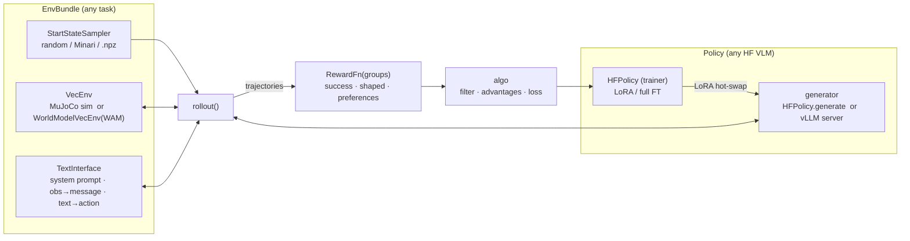
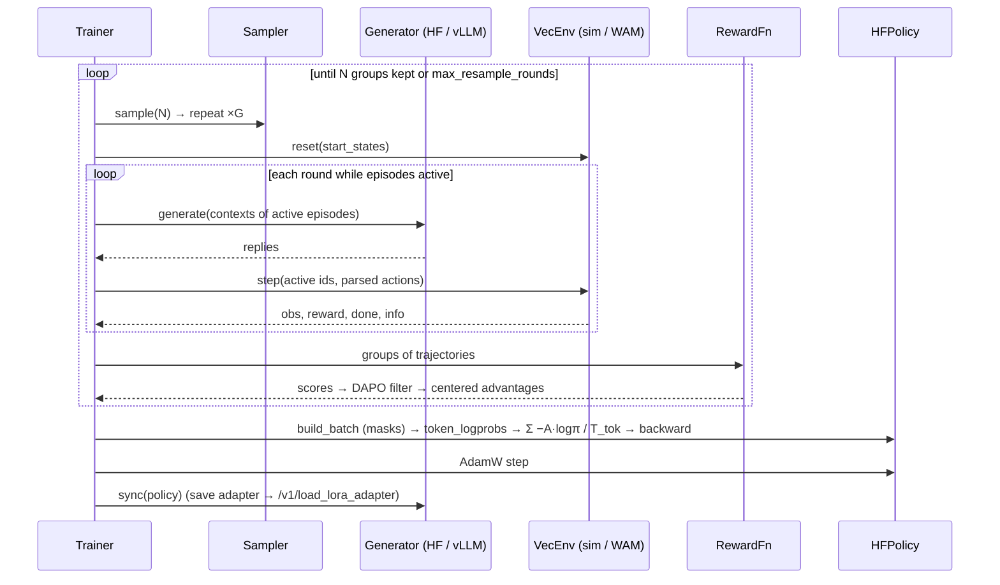
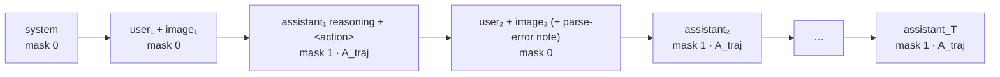
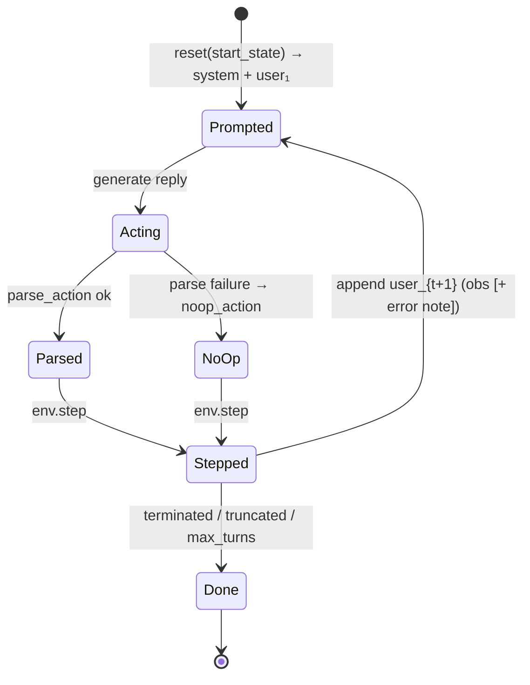

# vlmrl — minimal multi-turn VLM-RL for arbitrary HF VLMs and arbitrary environments

A small (~1.6k lines), readable reproduction of the training recipe in
[PEAR: Post-training Engine for Agentic Robotics](https://mit-han-lab.github.io/pear-blog/)
(MIT HAN Lab): a VLM is the policy, observes images + text each round, writes its reasoning and a
**text action**, and is trained with **GRPO-style RL from task outcomes only**. This repo
generalizes it in three directions:

1. **Any Hugging Face VLM** (`AutoModelForImageTextToText` + its processor's chat template). Tested:
   Qwen3-VL-4B, Qwen2.5-VL processor, SmolVLM-256M.
2. **Any environment** behind a three-piece interface (dynamics / text interface / start states), so
   a MuJoCo simulator and a **learned world-action model (WAM)** are interchangeable.
3. **Any reward signal**: success, shaped scalars, or **pairwise preferences** (e.g. from a WAM's
   preference head), all as one `groups -> scores` function.

It ships a **PointMaze** environment for VLM-RL (MuJoCo dynamics from gymnasium-robotics, the same
physics behind the D4RL/Minari `pointmaze` datasets), with exact **reset-to-state from offline data**.

> Status: verified end-to-end on 2×A6000 (`puget`) with Qwen3-VL-4B + LoRA, using both the HF
> and the vLLM rollout backends, with wandb logging. 100 tests (94 fast CPU tests + 6 `--run-slow` real-VLM tests). See [Results](#13-results-so-far).

---

## Contents

1. [Quickstart](#1-quickstart)
2. [What PEAR does and what this repo reproduces](#2-what-pear-does-and-what-this-repo-reproduces)
3. [Repository layout](#3-repository-layout)
4. [Core abstractions](#4-core-abstractions)
5. [The PointMaze environment](#5-the-pointmaze-environment)
6. [Plugging in a world-action model (WAM)](#6-plugging-in-a-world-action-model-wam)
7. [Rewards and preferences](#7-rewards-and-preferences)
8. [Using arbitrary Hugging Face VLMs](#8-using-arbitrary-hugging-face-vlms)
9. [The algorithm, precisely](#9-the-algorithm-precisely)
10. [Systems and optimizations](#10-systems-and-optimizations)
11. [Testing](#11-testing)
12. [Weights & Biases](#12-weights--biases)
13. [Results so far](#13-results-so-far)
14. [Limitations and next steps](#14-limitations-and-next-steps)
15. [Diagrams](#15-diagrams)

---

## 1. Quickstart

```bash
# install (uv recommended)
uv venv -p 3.11 .venv
uv pip install -p .venv -e ".[pointmaze,offline,lora,wandb,dev]"

make test          # fast tests, CPU, no downloads (~10 s)
make test-slow     # + real tiny VLM (downloads SmolVLM-256M once)
make demo          # BFS oracle drives the env through the *text* interface -> outputs/demo/*.gif
```

**Train with in-process HF generation** (simplest; slow for long multi-image episodes):

```bash
python scripts/train.py --config configs/pointmaze_qwen3vl4b_lora.json --steps 100
```

**Train with a vLLM rollout server** (≈4–9× faster rollouts thanks to prefix caching; LoRA only):

```bash
# separate venv for vLLM so its pinned torch never fights the trainer's
uv venv --managed-python -p 3.12 ~/venvs/vllm && uv pip install -p ~/venvs/vllm/bin/python vllm
scripts/launch_vllm.sh Qwen/Qwen3-VL-4B-Instruct 8011 1          # model, port, GPU
CUDA_VISIBLE_DEVICES=0 python scripts/train.py --config configs/pointmaze_qwen3vl4b_vllm.json \
    --wandb_project vlm-rl-pointmaze --wandb_group my-sweep --wandb_run_name q3vl4b-success
```

Every `TrainConfig` field is a CLI flag (dict fields take JSON; `none` sets Optionals to None); CLI
flags override `--config`. Outputs land in `out_dir/`: `config.json`, `metrics.jsonl`,
`episodes/*.gif|txt` (sample transcripts), `ckpt_step*/`, `resume/state.pt`.

**Resuming.** Every step (`resume_every`) the trainer atomically writes `out_dir/resume/state.pt`
(trainable weights, optimizer, sampler RNG, that step's metrics). Re-running the same command
continues after the last checkpointed step: `metrics.jsonl` is truncated to that step, the same
wandb run id (`out_dir/wandb_run_id`) is resumed, and the vLLM server gets the restored adapter.
`--resume false` starts over. `scripts/sweep.py` relies on this, so re-running a sweep resumes it.

---

## 2. What PEAR does and what this repo reproduces

PEAR trains Qwen3.8-27B as a robot policy directly: each round the model sees camera frames + arm
state, reasons in text, and outputs an end-effector pose as JSON; IK and a controller execute it.
There are no perception tools, planners or skill libraries, only RL from task success.

| PEAR recipe (from the blog) | This repo | Notes |
|---|---|---|
| GRPO, groups of 8 rollouts per start state | `group_size=8` | groups share a start state |
| 128 groups per step (after filtering) | `groups_per_step` (default 8) | small-scale default |
| DAPO **group filter** | `filter_groups=True`, `max_resample_rounds` | drops zero-variance groups, resamples |
| **Score Centering** | `adv_mode="center"` (A = s − mean(s)) | blog cites Marek & Ryabinin without a formula; plain mean-centering is our reading. `zscore` (GRPO) and `rloo` also available |
| REINFORCE loss, "bypass mode", **no PPO clipping** | `ppo_epochs=1` → L = −A·log π | `ppo_epochs>1` enables a DAPO clip-higher surrogate |
| token-mean loss | sum over tokens / **global** token count | exact under any micro-batching |
| no KL, no entropy bonus | none | |
| 1 optimizer update per step | yes | |
| AdamW, lr 1e-6 | AdamW, `lr` | 1e-6 is for 27B full FT; LoRA on 2–8B wants ~1e-5–5e-5 |
| temperature 1.0, full distribution | `temperature=1.0, top_p=1, top_k=0` | overrides checkpoints' generation_config (Qwen ships top_k=1) |
| Earlier rounds stay in context (39–59 images/episode) | `max_images=None, max_frames=None` (default) | `max_images=k` keeps the last k images; `max_frames=k` keeps only the last k rounds |
| Binary success reward | `reward="success"` | plus shaped / preference rewards |
| Text action (JSON pose) | `<action>{"dx":…, "dy":…}</action>` | parsed by the env's `TextInterface` |
| veRL + LMCache, fully async, FSDP×SP, TP rollouts | single-process trainer + optional vLLM server w/ prefix caching | see §10 and §14 |

The blog doesn't specify the exact prompts, how parse failures are handled, the Score Centering
formula, or the exact sample construction. Choices made here are documented where they are implemented.

---

## 3. Repository layout

```
vlmrl/
  types.py            Obs, StepResult, Turn, Trajectory
  envs/
    base.py           VecEnv / TextInterface / StartStateSampler protocols, EnvBundle
    pointmaze.py      MuJoCo PointMaze VecEnv, top-down renderer, text interface, samplers, BFS oracle
    world_model.py    WorldActionModel protocol + WorldModelVecEnv adapter
  rollout.py          batched multi-turn rollout loop, context windowing, trajectory -> samples
  rewards.py          group reward fns: success/return/info/format/efficiency, preferences (win-rate, Bradley-Terry)
  algo.py             group advantages, DAPO filter, REINFORCE / PPO-clip token loss (summed)
  policy.py           HFPolicy: generate, multi-turn loss masks, logits_to_keep + chunked fp32 log-probs, LoRA
  vllm_client.py      VLLMServerGenerator: OpenAI-API rollouts + LoRA hot-swap weight sync
  trainer.py          TrainConfig + Trainer (collect -> filter -> advantages -> update -> eval/log/save)
examples/toy_wam.py   toy kinematic "WAM" + preference head, showing the WAM integration path
scripts/
  train.py            CLI (auto-generated from TrainConfig)
  demo_pointmaze.py   oracle/random policies through the text interface, GIFs
  launch_vllm.sh      vLLM server launcher
configs/              JSON presets (LoRA/HF, LoRA/vLLM, PEAR-like full FT, toy WAM + prefs)
tests/                pytest suites (one per module) + conftest tiers/fixtures
```

---

## 4. Core abstractions

The trainer only ever sees five interfaces. Each is a `typing.Protocol`, so any object with the
right methods works and no inheritance is needed.

| Interface | Methods | Implementations here |
|---|---|---|
| `VecEnv` (dynamics) | `reset(start_states) -> [Obs]`, `step(ids, actions) -> [StepResult]`, `close()` | `PointMazeSimVecEnv`, `WorldModelVecEnv(wam)` |
| `TextInterface` (agent protocol) | `system_prompt(s)`, `observation_message(obs, turn, last, parse_error)`, `parse_action(text)`, `noop_action()` | `PointMazeTextInterface` |
| `StartStateSampler` | `sample(n, rng) -> [dict]` | `RandomStartSampler`, `OfflineStartSampler` (Minari id or `.npz`) |
| `RewardFn` | `groups: list[list[Trajectory]] -> list[list[float]]` | `rewards.py` (`build_reward(spec)`) |
| generator | `generate(convs, max_new_tokens, temperature, top_p, batch) -> [str]` | `HFPolicy`, `VLLMServerGenerator` |

**Why split dynamics from the text interface?** The same prompt, observation formatting and
action parser must drive both the simulator and the WAM, so the policy faces exactly the same task
in both. Only `VecEnv` changes.

**Why slot-indexed `step(ids, actions)`?** Episodes finish at different times. The rollout loop
steps only the unfinished slots, so a WAM does one batched forward pass over the active set.

**Adding a new environment** = write an `EnvBundle` factory and pass `--env my.module:make_bundle
--env_kwargs '{...}'` (or add it to `ENV_REGISTRY` in `trainer.py`).

```python
EnvBundle(make_vec_env=lambda: MyVecEnv(...), interface=MyTextInterface(...),
          train_sampler=MySampler(...), eval_sampler=MySampler(...), max_turns=20)
```

---

## 5. The PointMaze environment

**Dynamics.** gymnasium-robotics `PointMazeEnv` (MuJoCo point mass, force actions in [−1,1]²,
dt=0.01, success when ‖pos−goal‖ ≤ 0.45). `PointMazeSimVecEnv` keeps a pool of these and supports
**exact reset-to-state**: `{"qpos": [x,y], "qvel": [vx,vy], "goal": [gx,gy]}` (via
`point_env.set_state` + goal site update). `continuing_task=False`, so episodes end on success.

**Action space (what the VLM writes).**
- `action_mode="delta"` (default): `<action>{"dx": 0.5, "dy": -1.0}</action>` is a *relative
  waypoint* in maze units (1 cell = 1.0), clipped to `max_delta`. An inner PD controller
  (kp=10, kd=1) tracks it with raw forces for `action_repeat=40` physics steps (0.4 s); it settles
  a 1-cell move to ≈0.03 units. This mirrors how D4RL's PointMaze data was generated (a waypoint
  controller), and a momentum-driven point mass is very hard to control with raw forces from text.
- `action_mode="force"`: `{"fx":…, "fy":…}` held for `action_repeat` steps.
- Either way, the executed low-level forces are returned in `info["low_level_actions"]`, so VLM
  rollouts can also serve as WAM training data.
- Parsing takes the **last** `<action>…</action>`, tries JSON first, then falls back to the first two
  numbers. A parse failure executes a no-op and the next observation says so; the
  `format` reward can penalize it.

**Observations.** `render_topdown(maze_map, agent_xy, goal_xy, size)` is a *pure function of
low-dimensional state*: dark walls, light floor, faint cell grid, blue agent, green goal disc and
success-radius ring. So **offline datasets (which have no images) can be rendered identically**,
which matters if you train a WAM on Minari data. Optionally the prompt also verbalizes position,
velocity and goal (`include_state=True`). Set it to False for image-only control, or when a WAM
doesn't predict state.

<p align="center"> </p>

**Prompt** (system + per-round user message; see `outputs/demo/prompt.txt` after `make demo`):

```
SYSTEM: You control a small ball (BLUE dot) in a 2D maze, seen from directly above. Your goal is to
move the ball into the GREEN circle. The maze is 5 cells wide and 5 cells tall. Dark cells are walls ...
Coordinates: x increases to the right, y increases upward, (0, 0) is the centre of the image.
Each round you see the current view and choose a relative waypoint {"dx": <float>, "dy": <float>} ...
Think briefly, then end your reply with exactly one action tag, e.g. <action>{"dx": 0.5, "dy": -1.0}</action>
USER:   <image> Round 3. Ball position: (0.60, -0.14), velocity: (0.00, 0.00). Goal position: (-1.17, 1.14). Choose your next action.
```

**Start states.**
- `start_states="random"`: uniform over free cells (+ uniform noise ±0.25), zero velocity,
  `min_goal_dist` apart.
- `start_states="D4RL/pointmaze/umaze-v2"` (any Minari id): random timesteps of offline
  trajectories, with real velocities and the dataset's goal. Episode id and timestep are kept in the
  state dict (`episode`, `t`), so a WAM can look up the matching reference frames/latents.
- `start_states="path/to/file.npz"` with arrays `qpos, qvel, goal` (+ any extra keys, passed through).

**Mazes.** `open, umaze, medium, large` (+ `*_diverse_gr`). Measured through the text interface
(`scripts/demo_pointmaze.py`, 30 turns):

| maze | BFS oracle success / mean turns | random-waypoint success |
|---|---|---|
| umaze | 1.00 / 3.8 | 0.25 |
| medium | 1.00 / 6.1 | 0.12 |
| large | 1.00 / 8.9 | 0.00 |

`oracle_delta(maze_map, pos, goal)` (BFS over cells, aim at the next cell centre) is exported for
sanity checks, SFT warm-start data, or as a privileged preference oracle.

---

## 6. Plugging in a world-action model (WAM)

Implement three batched methods and wrap the result in `WorldModelVecEnv`:

```python
class MyWAM:
    def init(self, start_states):          # offline reference states -> model states (e.g. encode frames)
        frames = [render_topdown(MAZE, s["qpos"], s["goal"]) for s in start_states]  # or dataset frames
        return self.encode(frames)
    def step(self, states, actions):       # actions: [B, 2] parsed text actions
        nxt = self.dynamics(states, actions)
        return nxt, self.decode(nxt), {"done": self.done_head(nxt)}   # optional: reward/success/state
    def render(self, states):
        return self.decode(states)

bundle = EnvBundle(
    make_vec_env=lambda: WorldModelVecEnv(MyWAM(...), carry_keys=("goal",)),
    interface=PointMazeTextInterface(maze_map, include_state=False),   # same prompt/parser as sim
    train_sampler=OfflineStartSampler("D4RL/pointmaze/umaze-v2"), eval_sampler=..., max_turns=10)
```

Rewards from the WAM's **preference head** plug in as a `PreferenceModel`:

```python
class WAMPreference:
    def compare(self, pairs):                       # [(traj_a, traj_b), ...] -> P(a ≻ b), batched
        return self.wam.prefer([a.frames for a, _ in pairs], [b.frames for _, b in pairs])

reward_fn = preference_reward(WAMPreference(wam), mode="winrate")      # or mode="bt"
Trainer(cfg, bundle=bundle, reward_fn=reward_fn).train()
```

`examples/toy_wam.py` is a runnable stand-in: a kinematic "WAM" (position += clipped delta,
walls ignored) plus a progress-based preference head. It runs with `configs/pointmaze_toy_wam_prefs.json`
(offline Minari start states + preference rewards) and was verified to train with Qwen3-VL-4B.

Because a GRPO group = G rollouts **from the same reference state**, within-group preferences are
exactly the comparisons a WAM can make reliably. Absolute calibration across start states isn't
needed, since advantages are centered within each group anyway.

---

## 7. Rewards and preferences

`--reward` accepts a compact spec, or `module:factory` returning a `RewardFn`:

| spec | meaning |
|---|---|
| `success` | 1 if any step reported `info["success"]` (PEAR) |
| `return` | sum of env rewards |
| `neg_dist` | −final distance to goal (PointMaze shaping) |
| `format` | −fraction of turns with unparseable actions |
| `efficiency` | `1 − turns/max_turns` for successful episodes |
| `pref_oracle_dist` | preference pipeline with a privileged oracle judge (lower final distance, success first) |
| `success+0.2*format+0.1*efficiency` | weighted sums |
| `examples.toy_wam:make_reward` | custom factory |

**Preferences → scores** (`preference_reward(model, mode, max_pairs)`): all C(G,2) within-group
pairs (or a random subset of `max_pairs`) are queried **in both orders** and averaged, which cancels
position bias (a judge that always prefers the first item yields exactly 0.5 for everyone).
- `winrate`: s_i = mean_j P(i ≻ j) ∈ [0,1] (Borda-style).
- `bt`: Bradley–Terry log-strengths fitted by the MM algorithm on soft outcomes.

Then advantages are computed within the group exactly as for scalar rewards, so scalar and
preference rewards can be mixed with `combine((success_reward(), 1.0), (preference_reward(...), 0.5))`.

---

## 8. Using arbitrary Hugging Face VLMs

`HFPolicy` relies only on `AutoProcessor` + `AutoModelForImageTextToText` + `processor.apply_chat_template`
with HF multimodal messages (`{"type": "image", "image": PIL}`), so model-specific details (image token
expansion, pixel tensor layouts, `image_grid_thw`, …) stay inside the processor.

Things to know when switching models:

- **Image token budget.** Use `--processor_kwargs`, e.g. Qwen: `'{"max_pixels": 200704}'`;
  SmolVLM/Idefics3: `'{"do_image_splitting": false}'` (otherwise each 336-px frame becomes ~1.1k tokens).
  Qwen3-VL at 336 px is ≈110 tokens/frame.
- **Prefix-stable chat templates** (§9.3) are required for full-context training. The first batch is
  checked automatically. If a template rewrites history (e.g. strips earlier `<think>` blocks), set
  `--max_images k`, which switches to per-turn samples that are always exact.
- **Generation config.** We always pass `temperature, top_p, top_k=0`, because some checkpoints ship
  near-greedy defaults (Qwen: `top_k=1`), which would silently kill exploration.
- **LoRA targets.** `--lora_targets all-linear` (default) adapts every linear layer, including the
  vision tower. With the vLLM backend, restrict LoRA to the language model, e.g.
  `".*language_model.*\.(q_proj|k_proj|v_proj|o_proj|gate_proj|up_proj|down_proj)"` (see `configs/pointmaze_qwen3vl4b_vllm.json`).
- **Qwen3-VL processors need `torchvision`** (a declared dependency).
- **SmolVLM2 processors need `num2words`** (`uv pip install num2words`, in the vLLM venv too). SmolVLM's
  LoRA targets are `.*text_model.*` (not `language_model`), its context is 8k (`--max-model-len 8192`), and
  the vLLM server must not split images either: `--mm-processor-kwargs '{"do_image_splitting": false}'`
  (`configs/sweeps/pointmaze_small.json` shows per-model sweep overrides for all of this).
- **Memory.** Full FT of a 4B model with AdamW needs ~48 GB+ before activations. Use LoRA on a single
  48 GB GPU. `gradient_checkpointing=True` by default. `micro_batch_size` sequences per backward.

---

## 9. The algorithm, precisely

### 9.1 One training step

1. Sample N start states; repeat each G times → N·G episodes (group *g* shares start state s_g).
2. Roll out all episodes in lock-step: each round, every unfinished episode gets one sampled reply
   (batched) and one env step (batched over active slots), until termination or `max_turns`.
3. Scores s_{g,i} = RewardFn(groups).
4. **DAPO filter:** keep group g iff std_i(s_{g,i}) > 0. Repeat 1–3 with fresh start states until N
   groups survive or `max_resample_rounds` is hit.
5. **Advantages** (trajectory-level, broadcast to every response token of every turn):
   - center: A_{g,i} = s_{g,i} − mean_j s_{g,j}
   - zscore: (s − mean)/(std + ε)
   - rloo: s_{g,i} − mean_{j≠i} s_{g,j}
6. **Loss** over all response tokens t of all kept trajectories, normalized by the global count T_tok:

   L = −(1/T_tok) Σ_{g,i,t} A_{g,i} · log π_θ(y_t | context_{<t})        (REINFORCE / "bypass")

   With `ppo_epochs>1`: L = −(1/T_tok) Σ min(r_t A, clip(r_t, 1−ε_lo, 1+ε_hi) A), r_t = π_θ/π_old,
   with ε_lo=0.2 and ε_hi=0.28 (DAPO clip-higher).
7. One AdamW step (grad-norm clip 1.0). Push weights to the rollout engine if it is separate.

Trajectories with A=0 are skipped (zero gradient). On-policy with one update per step, REINFORCE
and the PPO surrogate have identical gradients at r=1 (unit-tested).

### 9.2 Multi-turn samples

- `max_images=None` (PEAR): the whole episode is **one sequence**
  `[system, user₁(img), asst₁, user₂(img), asst₂, …]`, and the loss mask covers every assistant span.
  Each turn's tokens are conditioned on exactly the context the policy saw when generating them.
- `max_frames=k`: the context at turn t is the system prompt + only the last k rounds (observation
  message and the replies after it); older rounds are dropped, text included. Per-turn samples, as below.
  `max_frames=1` makes each turn a short single-frame prompt, which is cheap and is the right choice
  when the observation is Markov (PointMaze with `include_state=True`). The shipped PointMaze configs use it.
- `max_images=k`: the context at turn t keeps only the last k images (older ones become
  `[earlier image omitted]`), so contexts differ per turn and each turn becomes its own sample with
  exactly the view used at generation time (`rollout.context_view` is shared by rollout and training;
  this is unit-tested).

### 9.3 Loss masks without model-specific code

For assistant message k: `start = len(tok(messages[:k], add_generation_prompt=True))`,
`end = len(tok(messages[:k+1]))`, and mask[start:end] = 1. This covers the reply plus the
template's end-of-turn token (the model must learn to stop), and never covers prompts, images or
the generation header. Correctness relies on prefix stability, which is asserted on the first batch.
Tests check that the masked tokens decode to exactly the assistant replies, and that the masked
log-probs match a naive full forward pass.

Responses are re-tokenized from text for training (same as most HF-based RL stacks). Token-level
mismatch with the sampled ids is rare for special-token-delimited templates. PEAR's async version
handles residual mismatch with Score Centering, without truncated importance sampling.

---

## 10. Systems and optimizations

Kept deliberately small. What's implemented, and where it came from:

| Optimization | Where | Why |
|---|---|---|
| **Global token-count normalization** of summed micro-batch losses | `algo.policy_loss_sum`, `Trainer.update` | exact token-mean regardless of micro-batching (FeynRL `compute_global_token_denom`) |
| **`logits_to_keep`** from the first response token | `HFPolicy.token_logprobs` | skips the LM-head/vocab projection over the system prompt + first image |
| **Chunked fp32 log-softmax + gather** | `chunked_token_logprobs` | never materializes [B,T,V] fp32 (V≈152k for Qwen) (cf. FeynRL's fused compiled kernel) |
| **Length-sorted micro-batches** | `Trainer.update` | less padding |
| **Skip zero-advantage trajectories** | `Trainer.update` | free compute savings |
| **Adaptive generation batch** (halve on CUDA OOM, remember) | `HFPolicy.generate` | multi-image KV caches grow every turn |
| **LoRA (PEFT)** + gradient checkpointing | `HFPolicy` | 4–8B models on one 48 GB GPU |
| **vLLM server rollouts with automatic prefix caching** | `vllm_client.py` | multi-turn contexts share long prefixes, so prefill is reused (PEAR: veRL + LMCache, ~95% prefix hit rate) |
| **LoRA hot-swap weight sync** (`/v1/load_lora_adapter`) | `VLLMServerGenerator.sync` | trivial, robust weight sync without NCCL (FeynRL/veRL use NCCL broadcast for full weights) |
| NaN/inf guards on loss and grad norm | `Trainer.update` | skip bad micro-batches/steps instead of corrupting weights (FeynRL-style) |
| `PYTORCH_CUDA_ALLOC_CONF=expandable_segments:True` | `scripts/train.py` | fragmentation between generate and train phases |

Measured on puget (A6000, Qwen3-VL-4B LoRA, UMaze, 32 eval episodes, ≤10 turns): HF `generate`
≈ 9 min per eval vs vLLM ≈ 1 min. A training-step rollout of 64 episodes took ≈210 s with HF; with vLLM, three resampling rounds (up to ~190 episodes) take ≈120–150 s.

**Not implemented (yet):** async rollout/training overlap, multi-GPU data-parallel training
(FSDP/DeepSpeed), NCCL full-weight sync to vLLM, sequence packing, rollout-logprob importance
correction. See §14.

---

## 11. Testing

```bash
make test        # pytest                        -> fast tier: CPU, no downloads, ~10 s
make test-slow   # pytest --run-slow             -> + real SmolVLM-256M (mask, logits_to_keep, padding, CLI e2e)
make test-all    # pytest --run-slow --run-gpu
```

| file | covers |
|---|---|
| `test_pointmaze.py` | coordinate transform, renderer, exact reset-to-state, PD tracking, clipping, walls, force mode, early success termination, slot isolation, BFS oracle solves all mazes, parser (valid/invalid matrix), prompts, samplers (random, offline npz, filtering) |
| `test_rollout.py` | message structure, truncation, parse-failure no-op + feedback, finished episodes stop generating, context windowing, **rollout context == training sample context** |
| `test_rewards.py` | every scalar reward, combine, spec parsing, module-path rewards, preference ranking (win-rate/BT), position-bias cancellation, pair subsampling, BT recovery |
| `test_algo.py` | advantage modes, filter, REINFORCE gradient, PPO≡REINFORCE at ratio 1, clipping, global-token-normalization ≡ concatenated mean |
| `test_world_model.py` | WAM adapter slot bookkeeping/batching, done threshold, carry keys, toy WAM + preference rewards |
| `test_policy.py` | chunked log-probs (values & grads), adaptive OOM batching; *slow:* generate, mask spans, `logits_to_keep` alignment vs full forward, padding invariance |
| `test_vllm_client.py` | message conversion, request params/order, LoRA hot-swap protocol (fake HTTP server) |
| `test_trainer.py` | env registry, collect/filter/resample, update direction, PPO path, full loop (logs/eval/GIFs/ckpts), sync after update, wandb offline media, CLI parsing, shipped configs; *slow:* CLI e2e + real weight update |
| `test_types.py` | trajectory properties |

`tests/conftest.py` provides `FakePolicy` (a 4-parameter "model" with the `HFPolicy` interface),
so the whole trainer loop runs in milliseconds, plus scripted oracle/random text policies.
CI: `.github/workflows/tests.yml` runs the fast tier on every push/PR and the slow tier on push.

---

## 12. Weights & Biases

```bash
python scripts/train.py ... --wandb_project vlm-rl-pointmaze --wandb_group reward-sweep \
    --wandb_run_name q3vl4b-success --wandb_tags pointmaze,umaze,lora
```

Logged every step: `rollout/{success,score,turns,invalid_frac,resp_chars,groups_kept,rounds}`,
`train/{loss,grad_norm,tokens,sequences,mean_logp,clipfrac}`, `eval/{success,turns,invalid_frac}`,
`time/{rollout,train}`, plus `train/episode`, `eval/episode` (GIF) and `*/transcript` (HTML) media.
The full `TrainConfig` is the run config, so you can group and filter by `config.reward`,
`config.model`, `config.env_kwargs.maze`, etc. Unit-tested in offline mode.

---

## 13. Results so far

Qwen3-VL-4B-Instruct, LoRA r=64 (language model only), lr 2e-5, UMaze, `include_state=True`,
≤10 turns, 8 groups × 8, `reward=success`, vLLM rollouts, **full multi-turn history** (this predates
`max_frames`; the shipped config now sets `max_frames=1`):

| step | eval success (greedy, fixed 32 starts) | eval mean turns | rollout success (T=1.0) | rollout mean turns |
|---|---|---|---|---|
| 0 (zero-shot) | 0.625 | 6.03 | – | – |
| 1 | – | – | 0.48 | 6.71 |
| 5 | 0.656 | 5.66 | 0.66 | 6.35 |
| 10 | **0.906** | **4.94** | **0.91** | **4.26** |

About 2–4 min per step on 2×A6000 (vLLM on GPU1, trainer on GPU0). Wall-clock per step *falls* as the
policy improves (shorter episodes; rollout 149 s → 30 s), and fewer groups survive the DAPO filter
(more all-success groups), which is the expected signature of GRPO saturating on an easy maze. The
next step is harder settings (`medium`/`large`, `include_state=false`); see `configs/sweeps/`.
Runs live in wandb project `vlm-rl-pointmaze` (group `dev`).

Zero-shot, the model already uses the format perfectly (0% invalid). Its typical failure is
pushing into a wall repeatedly even though its position doesn't change, which is what RL needs to fix.

---

## 14. Limitations and next steps

- **Single trainer process.** Multi-GPU training would need DDP/FSDP; `n_tok` must then be
  all-reduced (the loss is already written as a sum for exactly this reason).
- **Synchronous.** PEAR is fully async (rollouts continue while training). The server backend is
  the natural place to add a staleness-bounded replay queue.
- **vLLM backend requires LoRA.** Full-FT weight sync needs an NCCL broadcast into the server.
- **Score Centering** is implemented as mean-centering. If you have the paper's exact form, swap it
  into `algo.group_advantages`.
- **Re-tokenization** of responses instead of token-in/token-out. Fine for these templates.
  Store sampled ids from vLLM (`return_tokens_as_token_ids`) if you need exactness.
- **PointMaze WAM mode** without state verbalization makes the task image-only. Either predict state
  with the WAM (`extras["state"]`) or train with `include_state=False` in the simulator too, so that
  sim and WAM tasks match.

---

## 15. Diagrams

### 15.1 System overview



### 15.2 One training step



### 15.3 Multi-turn sequence and loss mask (`max_images=None`)



### 15.4 Rollout state machine (per episode slot)



### 15.5 Sim ↔ WAM swap and preference rewards

```mermaid
flowchart TB
  D["Offline data (Minari D4RL/pointmaze)"] -->|qpos, qvel, goal, episode, t| SS["OfflineStartSampler"]
  SS --> SIM["PointMazeSimVecEnv<br/>(MuJoCo, exact set_state)"]
  SS --> WAM["WorldModelVecEnv(MyWAM)<br/>init → step(batched) → frames"]
  D -.->|render_topdown(state)| FR["frames for WAM training"]
  SIM --> TR["trajectories (same TextInterface)"]
  WAM --> TR
  TR --> PR["PreferenceModel.compare(pairs, both orders)"]
  PR --> SC["win-rate / Bradley–Terry scores per group"]
  SC --> ADV["group-centered advantages → GRPO update"]
```
