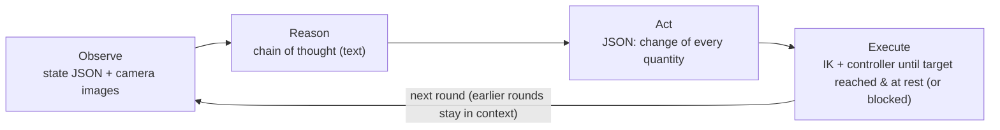
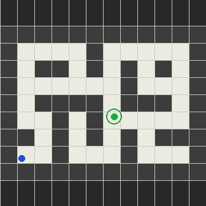
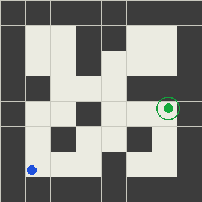
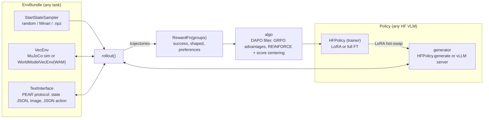
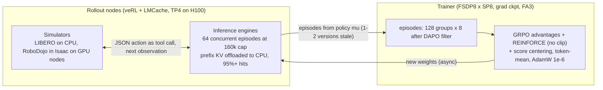
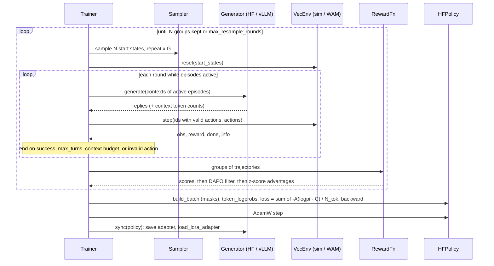
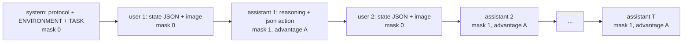
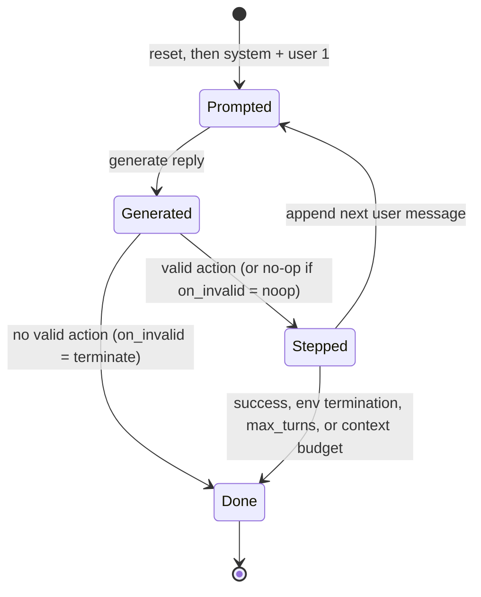
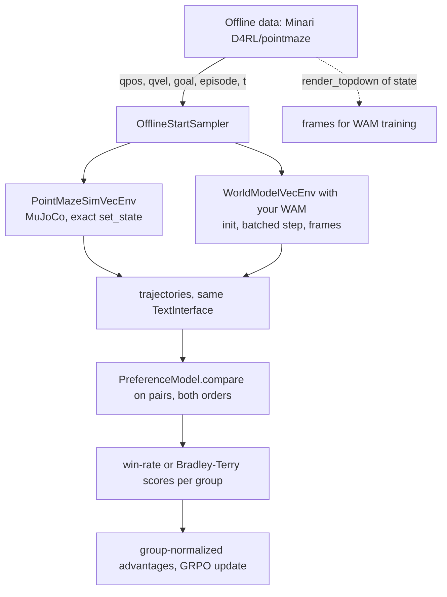

# vlmrl: minimal multi-turn VLM-RL for any HF VLM, any environment, any reward

A small (~1.8k-line library), readable reproduction of **robot-use reinforcement learning (RURL)**
as done by **PEAR**:
*Training Reasoning Models in Simulation to Natively Use Real Robots* (Tang, Zhang, Guo, … Han;
MIT HAN Lab, [arXiv:2611.18562](https://arxiv.org/abs/2611.18562),
[blog](https://mit-han-lab.github.io/pear-blog/), [code](https://github.com/mit-han-lab/pear)).
A VLM is the policy. Each round it sees the robot state and camera images, reasons in text, and
writes a JSON action. It is trained with GRPO from task success alone, with no harness and no
demonstrations.

This repo keeps that recipe and generalizes it:

1. **Any Hugging Face VLM** (`AutoModelForImageTextToText` + its processor's chat template). Tested:
   Qwen3-VL-4B / 2B, Qwen2.5-VL, SmolVLM-256M.
2. **Any environment** behind a three-piece interface (dynamics / text protocol / start states),
   so a MuJoCo simulator and a **learned world-action model (WAM)** are interchangeable.
3. **Any reward**: success, shaped scalars, or **pairwise preferences** (e.g. a WAM's preference
   head), all as one `groups -> scores` function.

It ships **PointMaze for VLM-RL**: MuJoCo dynamics from gymnasium-robotics (the physics behind the
D4RL/Minari `pointmaze` datasets), PEAR's exact prompt protocol, and exact
**reset-to-state from offline data**.

> **Status.** Verified on 2×A6000 with Qwen3-VL-4B + LoRA, using both the HF and the vLLM rollout
> backends, with wandb logging. UMaze eval success went **0.625 → 1.0 in 20 RL steps** (§14).
> 142 tests (136 fast CPU + 6 real-VLM), passing locally and on the GPU box.

---

## Contents

1. [Quickstart](#1-quickstart)
2. [How PEAR works (from the paper)](#2-how-pear-works-from-the-paper)
3. [PEAR ↔ this repo](#3-pear--this-repo)
4. [Repository layout](#4-repository-layout)
5. [Configuration (Hydra)](#5-configuration-hydra)
6. [Core abstractions](#6-core-abstractions)
7. [The PointMaze environment](#7-the-pointmaze-environment)
8. [Plugging in a world-action model (WAM)](#8-plugging-in-a-world-action-model-wam)
9. [Rewards and preferences](#9-rewards-and-preferences)
10. [Using arbitrary Hugging Face VLMs](#10-using-arbitrary-hugging-face-vlms)
11. [The algorithm as implemented](#11-the-algorithm-as-implemented)
12. [Systems and optimizations](#12-systems-and-optimizations)
13. [Testing](#13-testing)
14. [Weights & Biases, sweeps, results](#14-weights--biases-sweeps-results)
15. [Limitations and next steps](#15-limitations-and-next-steps)
16. [Diagrams](#16-diagrams)

---

## 1. Quickstart

```bash
uv venv -p 3.11 .venv
uv pip install -p .venv -e ".[pointmaze,offline,lora,wandb,dev]"     # + smolvlm for SmolVLM2

make test          # 136 fast tests, CPU, no downloads (~10 s)
make test-slow     # + 6 tests with a real tiny VLM (downloads SmolVLM-256M once)
make demo          # BFS oracle drives PointMaze through the text protocol -> outputs/demo/{*.gif,prompt.txt}
make smoke         # 1 RL step with SmolVLM-256M on CPU  (= scripts/train.py experiment=smoke)
```

**Train with in-process HF generation** (simplest; slow for long multi-image episodes):

```bash
python scripts/train.py steps=100                                  # Qwen3-VL-4B LoRA, PointMaze UMaze
python scripts/train.py policy=qwen3vl2b_lora env_kwargs.maze=medium reward='success+0.5*neg_dist'
```

**Train with a vLLM rollout server** (prefix caching makes rollouts ≈4–9× faster; LoRA only):

```bash
uv venv --managed-python -p 3.12 ~/venvs/vllm && uv pip install -p ~/venvs/vllm/bin/python vllm
scripts/launch_vllm.sh Qwen/Qwen3-VL-4B-Instruct 8011 1                       # model, port, GPU
CUDA_VISIBLE_DEVICES=0 python scripts/train.py experiment=pointmaze_q3vl4b_vllm \
    wandb_project=vlm-rl-pointmaze wandb_group=my-sweep wandb_run_name=q3vl4b-success
```

**Sweep** (reward × model grid into one wandb group, one vLLM server per model, resumable):

```bash
python scripts/sweep.py configs/sweeps/pointmaze_small.yaml --dry_run
python scripts/sweep.py configs/sweeps/pointmaze_small.yaml
python scripts/make_wandb_report.py --group pointmaze-small-v1 --takeaways takeaways.md
```

Outputs land in `out_dir/`: `.hydra/` (resolved config + overrides), `config.json`, `metrics.jsonl`,
`episodes/*.gif|txt` (sample transcripts), `ckpt_step*/`.

---

## 2. How PEAR works (from the paper)

### 2.1 The idea: a robot-use agent, like a computer-use agent

A computer-use agent observes a screenshot, reasons, and outputs a click that the OS executes.
PEAR's **robot-use agent (RUA)** does the same with a robot. It observes camera frames + arm state,
reasons in a chain of thought, and outputs the **next end-effector pose** as JSON. Inverse
kinematics + the robot's own controller execute it, then the next observation arrives. There are
**no perception tools, grasp/motion planners or skill libraries**: the model must localize objects
itself, decide how to manipulate them, and notice when a move failed. The instruction and **all
earlier rounds stay in context**, so each decision can use the whole episode.

Because actions are pose-level targets and the controller sits outside the model, **the protocol
is identical for every robot**. Only the list of parts and the description of frame/cameras change.
That's why a model trained only in simulation (LIBERO's single-arm Franka, RoboDojo's dual-arm ARX)
can be deployed zero-shot on a real dual-arm YAM it never saw.



### 2.2 The protocol (paper Appendix H, reproduced verbatim in `vlmrl/envs/protocol.py`)

The system prompt = a **fixed protocol** + a task-specific `## ENVIRONMENT` section + `## TASK`:

- **OBSERVATION.** The robot is a set of named *parts*, each with named *quantities you can set*.
  Every turn begins with the current value of every quantity as JSON
  (`{"left_arm": {"x": …, "y": …, "z": …, "roll": …}, "left_gripper": {"width": …}}`), followed by
  the camera images. Lengths are in centimeters, angles in radians. Nothing else says what a quantity means.
- **ACTION.** A JSON object of the same structure giving the **change** of every quantity
  (0 = leave as is). It is a *delta*, not an absolute pose.
- **EXECUTION.** The action ends once every target is reached and the robot is at rest. If something
  blocks a target, the robot stops there and the action ends. Then the next observation arrives.
- **RESPONSE FORMAT.** End the reply with exactly one fenced ```` ```json ```` block containing the action.
- **ENVIRONMENT.** The robot's frame, gripper conventions and each camera's orientation, e.g.
  *"agentview: a fixed camera; the robot's base is at the top of its image, +x points toward the
  bottom…"*, plus *"the episode ends by itself as soon as the task is done: while observations keep
  coming, the task is not done yet."*

During training the JSON action is executed as a **tool call** to the simulator, and the result is
the next observation.

### 2.3 The RL objective

An episode is τ = (o₁, y₁, …, o_T, y_T), with observations o_t and responses y_t
(reasoning + action). The policy π_θ generates each token given the context
h_t = (p, o₁, y₁, …, o_t), where p is the system prompt. The reward is **binary**: R(τ) = 1 if the
simulator reports success by the end of the episode, else 0. Training maximizes its expectation.

**Advantages: GRPO, Eq. 1.** Sample G episodes τ₁…τ_G that share a task *and an initial state*:

  Â_i = (R(τ_i) − mean_j R(τ_j)) / (std_j R(τ_j) + ε)

Every generated token of episode i (reasoning or action, in every round) receives Â_i.

**Gradient: REINFORCE + score centering, Eq. 2.** Averaged over the N generated tokens in the batch:

  g = (1/N) Σ_i Â_i Σ_{t,k} [ ∇_θ log π_θ(y^k_{i,t} | c^k_{i,t}) − E_{v∼μ(·|c^k_{i,t})} ∇_θ log π_θ(v | c^k_{i,t}) ]

Here y^k_{i,t} is the k-th token of the round-t response, c^k_{i,t} = (h_{i,t}, y^{<k}_{i,t}) its
context, and **μ the policy that generated the episode**. The first term is REINFORCE with the group
mean as baseline, **without PPO clipping** ("bypass mode"). Rollouts and updates are **fully
asynchronous**, so μ lags one or two versions behind π_θ. The second term is **score centering**
(Marek & Ryabinin, 2026), which corrects for that mismatch by subtracting from each token's score
function its expected value under the rollout policy's next-token distribution. PEAR uses it
**alone, without truncated importance sampling**. On-policy (μ = π_θ) the correction is exactly zero,
because Σ_v π(v)∇log π(v) = ∇Σ_v π(v) = 0.

**DAPO group filter.** Groups where every episode succeeds or every episode fails have zero
advantage. They are discarded and replaced, so each step trains on **128 groups × 8 rollouts counted
after filtering**.

**Episode termination.** An episode ends when the simulator reports success, the benchmark's step
limit is reached, the **context token budget** is reached (256k LIBERO / 160k RoboDojo), or **a
response contains no valid action**. On the real robot a trial also fails after 25 rounds or
>32k reasoning tokens in one round.

### 2.4 Training recipe (paper Table 1)

| Setting | Value |
|---|---|
| Base model | Qwen3.8-27B (open-weight reasoning VLM), reasoning effort **xhigh** in every rollout |
| RL algorithm | GRPO + DAPO group filter + score centering; REINFORCE loss in bypass mode, no PPO clipping |
| Batch | 128 groups of 8 rollouts per step, counted after the group filter |
| Optimization | AdamW, lr 1e-6, **one update per step**, token-mean loss, **no KL penalty, no entropy bonus** |
| Sampling | temperature 1.0 over the full distribution |
| Curriculum | LIBERO Goal+Spatial+Object (steps 1–148) → all 4 LIBERO suites (149–225) → RoboDojo `general_pickup` + `align_blocks` (226–340) |
| Max sequence | 256k tokens (LIBERO), 160k (RoboDojo); a **whole episode = one training sequence** |
| Framework | veRL, fully asynchronous; rollouts via veRL + LMCache (KV prefix offload to CPU, 95%+ prefix-cache hits) |
| Rollout parallelism | H100: TP4, 64 concurrent rollouts at 160k cap / 32 at 256k. GB300: TP2, no LMCache |
| Training parallelism | H100: FSDP8 × SP8 (32,512 tokens/GPU), FlashAttention-3, activation offload. GB300: FSDP4 × SP4 (69,632 tokens/GPU), FA-4. Gradient checkpointing throughout |
| Simulators | LIBERO rendered on the rollout nodes' CPUs; RoboDojo in Isaac containers on separate GPU nodes |
| Cost | ≈50,000 H100-equivalent GPU-hours |

**Why a curriculum.** With a binary reward, a task the model never solves gives no signal. The
base model succeeds on ~2% of LIBERO Goal/Spatial/Object episodes, 0.4% on LIBERO-Long, and almost
never on most RoboDojo tasks. So training starts on tasks with *some* signal and relies on transfer
(LIBERO-Long reaches 39% before it's ever trained on).

**Why the systems choices.** Episodes average **≈94k tokens** (1.8k prompt + 92k response) over
19.7 rounds with 39–59 images. Every round re-sends the whole context, so most of each request is a
prefix already processed. Hence LMCache prefix offload, and capping concurrent rollouts to keep the
prefix-cache hit rate ≥95%. Training whole episodes as single sequences needs FSDP × sequence
parallelism + gradient checkpointing.

### 2.5 Key results (for orientation)

| | Base Qwen3.8-27B | PEAR |
|---|---|---|
| LIBERO (2,000 episodes) | 1.6% | **74.4%** (GPT-6 Astra max effort 80.6%) |
| LIBERO-Pro (unseen task / swapped objects) | – | 57.4% / 57.5% (π₀.₅: 0.75% / 20.8%) |
| LIBERO-Long, zero-shot (never trained on) | 0.4% | 39.0% |
| RoboLab-120 (new benchmark) | 5.4% | 37.3% |
| Real dual-arm YAM, zero-shot sim-to-real | 0/30 | **18/30** |
| 9 general benchmarks (AIME, GPQA, MMMU, …) | 81.64 mean | 81.49 mean (all changes within 95% CI) |

From the paper's analysis: success depends strongly on reasoning **length**. The same model at low
effort uses 0.86k vs 3.23k thinking tokens per round and gets 21.9% vs 74.4% on LIBERO. Failures
are often **context exhaustion** (68.5% of RoboDojo failures). The paper's listed limitations:
slow, long reasoning (no length penalty); a small base model that needs detailed embodiment
descriptions in the prompt; and single-pose actions (no action chunks), which makes the controller
quality matter.

---

## 3. PEAR ↔ this repo

| PEAR | here | default / notes |
|---|---|---|
| GRPO advantages, Eq. 1 | `algo.group_advantages(mode="zscore")` | `adv_mode=zscore`; `center` (Dr.GRPO) and `rloo` also available |
| REINFORCE, bypass mode, no clipping | `algo.policy_loss_sum(old_logp=None)` | `policy_loss=reinforce`; `ppo_clip` (DAPO clip-higher) optional |
| Score centering, Eq. 2 | `algo.score_centering_term` | `score_centering=true`. Active whenever the batch is off-policy (`ppo_epochs>1`, i.e. later updates on a stale batch). On-policy it is exactly 0 and skipped. Uses μ's top-`score_centering_topk` tokens via the exact identity E_μ∇logπ = Σ_v(μ_v−π_v)∇logπ_v, so it stays exactly 0 when μ=π for any k |
| DAPO group filter, replace groups | `algo.keep_group`, `Trainer.collect` resampling | `filter_groups=true`, `max_resample_rounds` |
| 128 groups × 8 after filter | `groups_per_step`, `group_size` | 8 × 8 small-scale; `experiment=pear_recipe` uses 128 × 8 |
| token-mean over the batch's N tokens | Σ over micro-batches / global token count | exact under any micro-batching |
| no KL, no entropy, 1 update/step, AdamW | yes | `ppo_epochs=1`; `lr` 1e-6 for full FT, ~2e-5 for LoRA on 2–4B |
| temperature 1.0, full distribution | `temperature=1, top_p=1, top_k=0` | overrides checkpoint generation configs (Qwen ships `top_k=1`) |
| whole episode = one sequence, earlier rounds in context | `max_images=null` | `max_images=k` keeps the last k images (per-turn samples) |
| protocol of App. H | `vlmrl/envs/protocol.py` (verbatim template, state/action JSON, fenced-json parser) | `env_kwargs.prompt_style=pear`; `simple` is an older `<action>` format |
| EXECUTION: until reached & at rest, or blocked | `PointMazeSimVecEnv(settle=True)` | PD controller with reached / at-rest / blocked detection, capped at 200 substeps |
| episode ends on invalid action | `rollout(on_invalid="terminate")` | `on_invalid=terminate`; `noop` executes a no-op and tells the model |
| episode ends at the context budget | `rollout(max_context_tokens=…)` | `max_context_tokens` (from generator token counts) |
| binary success reward | `reward=success` | plus shaped / preference rewards |
| curriculum over task suites | change `env_kwargs` between runs / resume from `ckpt_step*` | no automatic curriculum scheduler yet |
| veRL async, FSDP×SP, LMCache, TP rollouts | single-process trainer + optional vLLM server (prefix caching, LoRA hot-swap) | see §12 and §15 |

---

## 4. Repository layout

```
vlmrl/
  types.py            Obs, StepResult, Turn, Trajectory (+ end_reason)
  config.py           Hydra glue: TrainConfig registered as the schema; compose() for tests/sweeps
  envs/
    base.py           VecEnv / TextInterface / StartStateSampler protocols, EnvBundle
    protocol.py       PEAR's robot-use protocol (App. H): system prompt, state JSON, fenced-json action parser
    pointmaze.py      MuJoCo PointMaze VecEnv (settle controller), renderer, text interface, samplers, BFS oracle
    world_model.py    WorldActionModel protocol + WorldModelVecEnv adapter
  rollout.py          batched multi-turn rollouts, PEAR termination rules, context windowing, samples
  rewards.py          group reward fns: success/return/info/format/efficiency, preferences (win-rate, Bradley–Terry)
  algo.py             GRPO advantages, DAPO filter, REINFORCE / PPO-clip token loss, score centering
  policy.py           HFPolicy: generate, multi-turn loss masks, logits_to_keep + chunked fp32 log-probs, LoRA
  vllm_client.py      VLLMServerGenerator: OpenAI-API rollouts + LoRA hot-swap weight sync
  trainer.py          TrainConfig (schema) + Trainer (collect -> filter -> advantages -> update -> eval/log/save)
configs/              Hydra: train.yaml + policy/ task/ rollout/ experiment/ groups; sweeps/*.yaml
examples/toy_wam.py   toy kinematic "WAM" + preference head (the WAM integration path, runnable)
scripts/              train.py (Hydra CLI), sweep.py, make_wandb_report.py, demo_pointmaze.py, launch_vllm.sh
tests/                pytest suites (one per module) + conftest tiers/fixtures
```

---

## 5. Configuration (Hydra)

The dataclass `vlmrl.trainer.TrainConfig` is the **schema**. It's registered with Hydra's
ConfigStore, so every key is type-checked and a typo or wrong type fails before anything launches.
YAML in `configs/` only sets values:

```
configs/train.yaml          defaults: [train_schema, _self_, policy: qwen3vl4b_lora, task: pointmaze, rollout: hf, experiment: null]
configs/policy/             qwen3vl4b_lora, qwen3vl2b_lora, qwen25vl3b_lora, smolvlm2_2b_lora, smolvlm256m, qwen25vl7b_full
configs/task/               pointmaze (env + env_kwargs + reward), toy_wam (WAM + preferences + Minari starts)
configs/rollout/            hf, vllm
configs/experiment/         pointmaze_q3vl4b_vllm (verified run), pear_recipe (Table 1), toy_wam_prefs, smoke
configs/sweeps/             grids for scripts/sweep.py
```

Group files are `# @package _global_`, so they set top-level fields. `experiment/` is applied
last and can `override /policy: …`. Groups are named `policy`/`task` so they don't collide with
the `model`/`env` fields.

```bash
python scripts/train.py --cfg job experiment=pear_recipe          # print the resolved config
python scripts/train.py policy=qwen25vl3b_lora rollout=vllm env_kwargs.start_states=D4RL/pointmaze/umaze-v2
python scripts/train.py +processor_kwargs.max_pixels=200704 max_images=4 on_invalid=noop
python scripts/train.py -m reward=success,neg_dist out_dir='runs/m/${hydra:job.num}'   # Hydra multirun
```

`scripts/sweep.py` composes every grid point up front, then runs them grouped by model so each
model's vLLM server starts once. Finished runs are skipped, so re-running a sweep resumes it.

---

## 6. Core abstractions

The trainer only sees five interfaces, each a `typing.Protocol` (duck-typed, no inheritance):

| Interface | Methods | Implementations |
|---|---|---|
| `VecEnv` (dynamics) | `reset(start_states) -> [Obs]`, `step(ids, actions) -> [StepResult]`, `close()` | `PointMazeSimVecEnv`, `WorldModelVecEnv(wam)` |
| `TextInterface` (agent protocol) | `system_prompt(s)`, `observation_message(obs, turn, last, parse_error)`, `parse_action(text)`, `noop_action()`, (`format_action(a)`) | `PointMazeTextInterface` (built on `envs/protocol.py`) |
| `StartStateSampler` | `sample(n, rng) -> [dict]` | `RandomStartSampler`, `OfflineStartSampler` (Minari id or `.npz`) |
| `RewardFn` | `groups: list[list[Trajectory]] -> list[list[float]]` | `rewards.build_reward(spec)` |
| generator | `generate(convs, max_new_tokens, temperature, top_p, batch) -> [str]` (+ `last_num_tokens`) | `HFPolicy`, `VLLMServerGenerator` |

- **Dynamics are separate from the text interface** so that the same prompt, observation format and
  parser drive both the simulator and a WAM. The policy faces an identical task either way, which is
  PEAR's "same protocol in sim and on the real robot" idea applied to sim vs WAM.
- **`step(ids, actions)` is slot-indexed.** Episodes end at different times. Only unfinished slots
  are stepped, so a WAM does one batched forward over the active set.
- **New environment** = an `EnvBundle` factory, selected with `env=my.module:make_bundle env_kwargs={...}`
  (or registered in `ENV_REGISTRY`). For a robot, `protocol.system_prompt(ENVIRONMENT, TASK)` +
  `protocol.parse_action(text, {"left_arm": ["x","y","z",...], ...})` gives you PEAR's interface directly.

---

## 7. The PointMaze environment

**Dynamics.** gymnasium-robotics `PointMazeEnv`: a MuJoCo point mass, force actions in [−1,1]²,
dt = 0.01, success when ‖pos − goal‖ ≤ 0.45. `PointMazeSimVecEnv` pools these and supports **exact
reset-to-state** (`{"qpos", "qvel", "goal"}` via `set_state` + goal-site update). Episodes end on
success (`continuing_task=False`).

**PEAR protocol mapping.** The robot is one part, `ball`, with settable quantities `x, y`:

```
USER:      {"ball": {"x": -4.73, "y": -3.24}}
           <image>
ASSISTANT: …reasoning…
           ```json
           {"ball": {"x": 0.5, "y": 0.0}}
           ```
```

The action is the **change** of position (maze units, 1 cell = 1, clipped to `max_delta=1`). As in
PEAR's EXECUTION section, a PD controller (kp=10, kd=1) drives raw forces **until the target is
reached and the ball is at rest** (‖err‖<0.05, ‖v‖<0.1), **or until blocked** (moved <0.01 over 20
physics steps, e.g. against a wall), capped at 200 substeps. `info["stop"]` records which happened,
and the executed force sequence is returned in `info["low_level_actions"]` (useful as WAM training
data). The ENVIRONMENT section describes the frame, walls, grid and the top camera. The TASK says
"Move the ball into the GREEN circle." When `include_state=true` it adds the goal's coordinates.
`prompt_style=simple` (`<action>{"dx","dy"}</action>`, velocity in the prompt) and
`action_mode=force` remain available.

**Observations.** `render_topdown(maze_map, agent_xy, goal_xy, size)` is a *pure function of
low-dimensional state*: dark walls, light floor, faint cell grid, blue agent, green goal disc and
success-radius ring. **Offline datasets (which have no images) can be rendered identically**, which
you need to train a WAM on Minari data.

<p align="center"> </p>

**Start states.** `start_states=random` samples free cells (± 0.25 noise, zero velocity,
`min_goal_dist` apart). `start_states=D4RL/pointmaze/umaze-v2` (any Minari id) samples random
timesteps of offline trajectories, with real velocities and the dataset's goal. `episode` and `t`
are kept in the state dict, so a WAM can look up the matching reference frames. `start_states=path.npz`
reads `qpos, qvel, goal` (+ extra keys, passed through).

**Mazes and the oracle.** `open, umaze, medium, large` (+ `*_diverse_gr`). `oracle_delta` (BFS over
cells, aim at the next cell centre) solves every maze through the text protocol:

| maze | BFS oracle success / mean rounds | random-waypoint success |
|---|---|---|
| umaze | 1.00 / 3.8 | 0.25 |
| medium | 1.00 / 6.1 | 0.12 |
| large | 1.00 / 8.9 | 0.00 |

---

## 8. Plugging in a world-action model (WAM)

Implement three batched methods and wrap them in `WorldModelVecEnv`:

```python
class MyWAM:
    def init(self, start_states):          # offline reference states -> model states (e.g. encode frames)
        frames = [render_topdown(MAZE, s["qpos"], s["goal"]) for s in start_states]  # or dataset frames
        return self.encode(frames)
    def step(self, states, actions):       # actions: [B, 2] parsed JSON actions
        nxt = self.dynamics(states, actions)
        return nxt, self.decode(nxt), {"done": self.done_head(nxt)}   # optional: reward/success/state
    def render(self, states):
        return self.decode(states)

bundle = EnvBundle(
    make_vec_env=lambda: WorldModelVecEnv(MyWAM(...), carry_keys=("goal",)),
    interface=PointMazeTextInterface(maze_map, include_state=False),   # same PEAR protocol as the sim
    train_sampler=OfflineStartSampler("D4RL/pointmaze/umaze-v2"), eval_sampler=..., max_turns=10)
```

Rewards from the WAM's **preference head** plug in as a `PreferenceModel`:

```python
class WAMPreference:
    def compare(self, pairs):                       # [(traj_a, traj_b), ...] -> P(a ≻ b), batched
        return self.wam.prefer([a.frames for a, _ in pairs], [b.frames for _, b in pairs])

reward_fn = preference_reward(WAMPreference(wam), mode="winrate")      # or mode="bt"
Trainer(cfg, bundle=bundle, reward_fn=reward_fn).train()
```

`examples/toy_wam.py` (`experiment=toy_wam_prefs`) is a runnable stand-in: a kinematic "WAM" plus a
progress-based preference head, with Minari offline start states. It was verified to train with
Qwen3-VL-4B. A GRPO group = G rollouts **from the same reference state**, so within-group
preferences are exactly the comparisons a WAM can make reliably. No cross-state calibration is
needed, since advantages are normalized within each group.

---

## 9. Rewards and preferences

`reward=` takes a compact spec, or `module:factory` that returns a `RewardFn`:

| spec | meaning |
|---|---|
| `success` | 1 if any step reported `info["success"]` (PEAR) |
| `return` | sum of env rewards |
| `neg_dist` | −final distance to goal (PointMaze shaping; carried through invalid-action endings) |
| `format` | −fraction of turns with unparseable actions |
| `efficiency` | `1 − turns/max_turns` for successful episodes |
| `pref_oracle_dist` | preference pipeline with a privileged oracle judge (success first, then lower final distance) |
| `success+0.5*neg_dist` | weighted sums (quote it on the CLI: `reward='success+0.5*neg_dist'`) |
| `examples.toy_wam:make_reward` | custom factory |

**Preferences → scores** (`preference_reward(model, mode, max_pairs)`): all C(G,2) within-group
pairs (or `max_pairs` of them) are queried **in both orders** and averaged, which cancels position
bias. `winrate`: s_i = mean_j P(i ≻ j). `bt`: Bradley–Terry log-strengths (MM algorithm on soft
outcomes). Advantages are then computed exactly as for scalar rewards, and `combine(...)` mixes
scalar and preference terms.

---

## 10. Using arbitrary Hugging Face VLMs

`HFPolicy` only uses `AutoProcessor` + `AutoModelForImageTextToText` + `processor.apply_chat_template`
on HF multimodal messages, so model specifics (image-token expansion, pixel layouts, `image_grid_thw`)
stay inside the processor.

- **Image token budget:** `+processor_kwargs.max_pixels=200704` (Qwen), `processor_kwargs={do_image_splitting: false}`
  (SmolVLM/Idefics3, otherwise ~1.1k tokens/frame). Qwen3-VL at 336 px ≈ 110 tokens/frame.
- **Prefix-stable chat templates** are required for whole-episode sequences. This is checked on the first batch.
  If a template rewrites history (e.g. strips earlier `<think>`), set `max_images=<int>`, which
  switches to per-turn samples that are always exact.
- **Generation config:** `temperature, top_p, top_k=0` are always passed, because checkpoints may ship
  near-greedy defaults (Qwen: `top_k=1`) that would silently kill exploration.
- **LoRA targets:** the policy presets restrict LoRA to language-model linears
  (`.*language_model.*\.(q|k|v|o|gate|up|down)_proj`), which vLLM can serve. `all-linear` also adapts the vision tower (HF backend only).
- **SmolVLM2** (`policy=smolvlm2_2b_lora`): its processor needs `num2words` (trainer *and* vLLM venv),
  its LoRA targets are named `.*text_model.*`, its context is 8k, and the vLLM server must not split
  images either (`--max-model-len 8192 --mm-processor-kwargs '{"do_image_splitting": false}'`, see
  `vllm_args` in `configs/sweeps/pointmaze_small.yaml`).
- **Qwen3-VL processors need `torchvision`** (declared). **Memory:** full FT of 4B with AdamW is
  ≈48 GB before activations, so use LoRA on one 48 GB GPU. Gradient checkpointing is on by default.

---

## 11. The algorithm as implemented

**One step** (`Trainer.collect` → `Trainer.update`):

1. Sample N start states, repeat each G times; roll out all N·G episodes in lock-step. Each round,
   every unfinished episode gets one sampled reply (batched) and one env step (batched over
   active slots).
2. An episode ends on success / env termination, `max_turns`, `max_context_tokens`, or an invalid
   action (`on_invalid=terminate`). `end_reason` is logged (`rollout/end_*`).
3. Scores = `RewardFn(groups)`. **DAPO filter**: keep a group iff std > 0. Resample fresh groups
   until N survive or `max_resample_rounds`.
4. **Advantages** (Eq. 1): Â = (s − mean)/(std + ε), broadcast to every response token of every round.
5. **Loss** over all response tokens, normalized once by the global token count N_tok:
   L = −(1/N_tok) Σ Â · (log π_θ(y_t) − C_t), where C_t is the score-centering surrogate
   Σ_{v∈top-k(μ)} (μ_v − sg[π_θ(v)]) · log π_θ(v). Its gradient is E_μ[∇log π_θ] (up to the top-k tail),
   and it is exactly 0 when μ = π_θ. With `ppo_epochs=1` (PEAR) the batch is on-policy, so C_t ≡ 0 and it is
   skipped. With `ppo_epochs>1`, μ's top-k is snapshotted before the first update and later passes are corrected.
6. One AdamW step (grad-norm clip 1.0, NaN/inf guards), then push the weights to the rollout engine.

**Multi-turn sequences.** With `max_images=null` (PEAR) an episode is **one sequence**
`[system, user₁(state, img), asst₁, user₂, asst₂, …]` and the loss mask covers every assistant span.
**Mask construction is model-agnostic**: for assistant message k,
`start = len(tok(messages[:k], add_generation_prompt=True))` and `end = len(tok(messages[:k+1]))`.
That covers the reply plus its end-of-turn token, and never covers prompts, images or the generation
header. Tests check that the masked tokens decode to exactly the replies and that the masked log-probs
match a naive full forward pass. Responses are re-tokenized from text, which is standard for HF-based
RL. PEAR's own residual rollout/learner mismatch is what score centering handles.

---

## 12. Systems and optimizations

| Optimization | Where | Why |
|---|---|---|
| Global token-count normalization of summed micro-batch losses | `algo.policy_loss_sum`, `Trainer.update` | exact token-mean regardless of micro-batching (FeynRL-style) |
| `logits_to_keep` from the first response token | `HFPolicy.token_logprobs` | skip the vocab projection over the system prompt + first image |
| Chunked fp32 log-softmax + gather (and top-k / gather for score centering) | `chunked_token_stats` | never materialize [B,T,V] fp32 (V≈152k) |
| Length-sorted micro-batches; skip zero-advantage trajectories | `Trainer.update` | less padding, free compute savings |
| Adaptive generation batch (halve on CUDA OOM, remember) | `HFPolicy.generate` | multi-image KV caches grow every round |
| LoRA (PEFT) + gradient checkpointing | `HFPolicy` | 2–8B models on one 48 GB GPU |
| vLLM server rollouts with automatic prefix caching | `vllm_client.py` | multi-round contexts share long prefixes (PEAR: LMCache, 95%+ hits) |
| LoRA hot-swap weight sync (`/v1/load_lora_adapter`) | `VLLMServerGenerator.sync` | robust sync without NCCL |
| `PYTORCH_CUDA_ALLOC_CONF=expandable_segments:True` | `scripts/train.py` | fragmentation between generate and train phases |

Measured on an A6000 (Qwen3-VL-4B LoRA, UMaze, 32 eval episodes): HF `generate` ≈9 min vs vLLM ≈1 min per eval.

---

## 13. Testing

```bash
make test        # pytest                  136 fast tests: CPU, no downloads, ~10 s
make test-slow   # pytest --run-slow       + 6 real SmolVLM-256M tests (masks, logits_to_keep, padding, CLI e2e)
make test-all    # pytest --run-slow --run-gpu
```

| file | covers |
|---|---|
| `test_protocol.py` | PEAR template sections/substitution, state JSON, fenced-json extraction, "every quantity" rule |
| `test_pointmaze.py` | coordinates, renderer, reset-to-state, PD tracking, clipping, walls, force mode, **settle: reached / blocked / cap**, early success, slot isolation, oracle solves all mazes, both prompt styles + parsers, samplers |
| `test_rollout.py` | structure, max-turns, **invalid → terminate (PEAR)** / noop, empty-step guard, **context budget**, end reasons, finished episodes stop generating, windowing, rollout context == training sample |
| `test_algo.py` | z-score / center / rloo, filter, REINFORCE gradient, PPO≡REINFORCE at ratio 1, clipping, global-token normalization, **score centering = 0 on-policy and = E_μ∇logπ with full support** |
| `test_rewards.py` | every scalar reward, combine, specs, module-path rewards, win-rate/BT ranking, position-bias cancellation, pair subsampling |
| `test_world_model.py` | WAM adapter bookkeeping/batching, done threshold, carry keys, toy WAM + preferences |
| `test_policy.py` | chunked log-probs (values, grads), adaptive OOM batching; *slow:* generate, mask spans, `logits_to_keep` vs full forward, padding invariance |
| `test_vllm_client.py` | message conversion, request params/order, LoRA hot-swap protocol (fake HTTP server) |
| `test_sweep.py` | Hydra grid expansion (model-major, policy presets carry per-model settings), shipped sweep composes, `stop_server` kills a SIGTERM-ignoring server and its children |
| `test_trainer.py` | registry, collect/filter/resample, update direction, PPO path, **multi-epoch score centering wiring**, full loop, sync after update, wandb offline media, **Hydra defaults/overrides/type errors, every experiment & policy preset composes**; *slow:* CLI e2e + real weight update |

`tests/conftest.py` provides `FakePolicy` (a 4-parameter "model" with the `HFPolicy` interface) so
the whole trainer loop runs in milliseconds, plus scripted oracle/random text policies for both
prompt styles. CI (`.github/workflows/tests.yml`) runs the fast tier on every push/PR.

---

## 14. Weights & Biases, sweeps, results

```bash
python scripts/train.py ... wandb_project=vlm-rl-pointmaze wandb_entity=tri wandb_group=reward-sweep \
    wandb_run_name=q3vl4b-success wandb_tags='pointmaze,umaze,lora'
```

Logged every step: `rollout/{success,score,turns,invalid_frac,resp_chars,groups_kept,rounds,end_*}`,
`train/{loss,grad_norm,tokens,sequences,mean_logp,clipfrac}`, `eval/{success,turns,invalid_frac,end_*}`,
`time/{rollout,train}`, plus `train|eval/episode` GIFs and `*/transcript` HTML. The full config is
the run config, so you can group by `config.reward`, `config.model`, `config.env_kwargs.maze`, etc.
`scripts/make_wandb_report.py` builds a comparison Report for a sweep group.

**Result (dev run, earlier `simple` prompt + `center` advantages + no-op on invalid).**
Qwen3-VL-4B-Instruct, LoRA r=64, lr 2e-5, UMaze, ≤10 rounds, 8 groups × 8, `reward=success`, vLLM rollouts:

| step | eval success (greedy, fixed 32 starts) | eval mean rounds | rollout success (T=1) | rollout mean rounds |
|---|---|---|---|---|
| 0 (zero-shot) | 0.625 | 6.03 | – | – |
| 5 | 0.656 | 5.66 | 0.54 | 6.35 |
| 10 | 0.906 | 4.94 | 0.93 | 4.26 |
| 20 | **1.000** | 5.16 | 0.99 | 4.74 |
| 40 | 1.000 | 4.91 | 1.00 | 4.51 |

Steps took about 2–4 min on 2×A6000 (vLLM on GPU1, trainer on GPU0). Wall-clock *falls* as the
policy improves (rollout 149 s → 30 s), and fewer groups survive the DAPO filter, which is GRPO
saturating on an easy maze. The zero-shot failure mode, pushing into a wall repeatedly, is what RL
removed.

**Verification of the PEAR-faithful code path** (GPU, Hydra CLI, `prompt_style=pear`, z-score
advantages, `on_invalid=terminate`, context budget). Qwen3-VL-2B LoRA, HF backend, 3 steps × 2
groups × 4: finite losses and gradients, 0% invalid actions, end reasons logged. It's a code-path
check, not a learning result. **Observation:** zero-shot, the 2B model under PEAR's protocol
often *echoes the current state JSON* (reading the action as an absolute pose rather than a change),
so with `reward=success` every group is all-fail and gets filtered. A dense term
(`success+0.5*neg_dist`) or a stronger/reasoning model gives signal. This matches the paper's note
that a small base model needs a detailed embodiment description in the prompt. The sweep in
`configs/sweeps/pointmaze_small.yaml` compares this across models and rewards.

---

## 15. Limitations and next steps

- **Synchronous, single trainer process.** PEAR is fully async (veRL) with FSDP × SP. Here the
  loss is already a global-token sum (ready for an all-reduced `n_tok`), and score centering is
  implemented, so an async rollout queue with staleness ≤2 would be the natural next step. For
  that, μ's top-k should come from the rollout engine (vLLM `top_logprobs`) rather than a trainer snapshot.
- **vLLM backend requires LoRA.** Full-FT weight sync would need an NCCL broadcast into the server.
- **Score centering uses μ's top-k** (default 32). The exact form needs μ's full next-token distribution.
- **No automatic curriculum.** Switch `env_kwargs` between runs and resume from `ckpt_step*`.
- **Re-tokenization** of responses instead of token-in/token-out (store vLLM token ids for exactness).
- **PointMaze vs WAM consistency:** if the WAM can't predict state, train the sim with
  `include_state=false` too, so the two tasks match.

---

## 16. Diagrams

### 16.1 System overview



### 16.2 PEAR's training system (paper Table 1 / App. A)



### 16.3 One training step (this repo)



### 16.4 Multi-turn sequence and loss mask (`max_images=null`)



### 16.5 Rollout state machine (per episode slot)



### 16.6 Sim ↔ WAM swap and preference rewards


