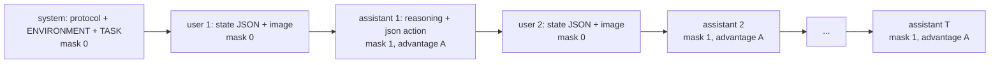
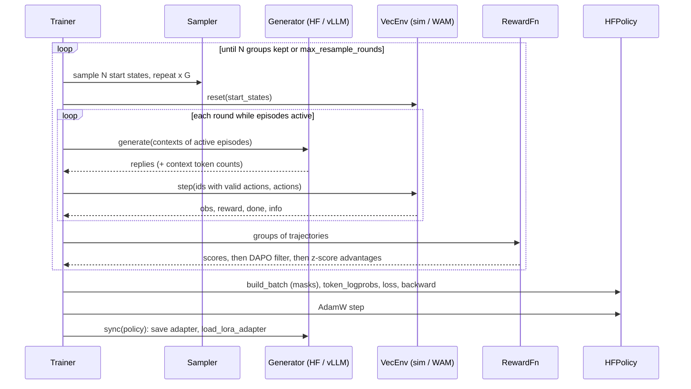

# Algorithm

What one call of `Trainer.collect()` + `Trainer.update()` computes. The paper-side derivation is in
[RL objective](../pear/objective.md).

## One step

1. **Collect.** Run N·G episodes (see [Rollouts](rollouts.md)). Compute scores = `RewardFn(groups)`.
2. **Filter** (`filter_groups`): keep group *g* iff \(\operatorname{std}_i s_{g,i} > 0\). Resample until N groups survive.
3. **Advantages** (`adv_mode`), per group:

    | mode | \(A_{g,i}\) |
    |---|---|
    | `zscore` (default, PEAR Eq. 1) | \((s - \bar s)/(\sigma_s + \epsilon)\) |
    | `center` | \(s - \bar s\) |
    | `rloo` | \(s_i - \operatorname{mean}_{j \neq i} s_j\) |

    The trajectory's advantage is broadcast to every response token of every round. Trajectories with
    \(A = 0\) are skipped, since they contribute zero gradient.
4. **Loss**, summed over all response tokens and divided **once** by the global token count \(N_{tok}\):

    \[
    L = -\frac{1}{N_{tok}} \sum_{\text{tokens}} A \,\big(\log \pi_\theta(y_t \mid c_t) - C_t\big)
    \]

    where \(C_t\) is the score-centering surrogate (below). With `policy_loss=ppo_clip`, the
    REINFORCE term is replaced by \(\min(rA, \operatorname{clip}(r, 1-\epsilon_{lo}, 1+\epsilon_{hi})A)\) with
    \(\epsilon_{lo}=0.2\) and \(\epsilon_{hi}=0.28\) (DAPO clip-higher).
    With `kl_coef` \(\beta > 0\) the loss adds \(\frac{\beta}{N_{tok}}\sum_{\text{tokens}} (e^{r_t} - r_t - 1)\),
    \(r_t = \log\pi_{ref}(y_t \mid c_t) - \log\pi_\theta(y_t \mid c_t)\): the k3 estimator of
    \(\mathrm{KL}(\pi_\theta \,\|\, \pi_{ref})\) on the sampled tokens (logged as `train/kl`), with \(\pi_{ref}\) the
    pretrained model (adapters disabled for LoRA; a frozen copy of the checkpoint for full fine-tuning, loaded on
    first use). Off by default, as in PEAR. It is the guard against the drift seen with SmolVLM-256M full FT at
    lr=3e-5: mean sampled log-prob fell from -2.3 to -8.3 and replies degenerated into gibberish.
5. **Update.** AdamW step with grad-norm clip 1.0, skipping non-finite losses or gradients. `lr_warmup_steps=N`
   ramps the lr linearly over the first N optimizer steps (off by default; logged as `train/lr`).
   Then push the weights to the rollout engine (vLLM backend).

`ppo_epochs` (default 1, as in PEAR) repeats step 4–5 on the same batch.

## Score centering

PEAR's correction (Eq. 2) is \(-\mathbb{E}_{v\sim\mu}\nabla\log\pi_\theta(v\mid c)\), where \(\mu\) is the
policy that generated the batch. vlmrl uses the identity

\[
\mathbb{E}_{v\sim\mu}\nabla\log\pi_\theta(v) = \sum_v (\mu_v - \pi_{\theta,v})\,\nabla\log\pi_{\theta,v}
\]

(which holds because \(\sum_v \pi_{\theta,v}\nabla\log\pi_{\theta,v} = 0\)) and evaluates it on \(\mu\)'s
top-k tokens (`score_centering_topk`, default 32):

\[
C_t = \sum_{v \in \text{top-}k(\mu)} \big(\mu_v - \operatorname{sg}[\pi_{\theta,v}]\big) \log \pi_{\theta,v}
\]

- \(\nabla C_t \approx \mathbb{E}_\mu \nabla \log \pi_\theta\), and the only error is the tail mass outside the top-k.
- When \(\mu = \pi_\theta\), \(C_t\) has **exactly zero gradient for any k**.
- **When it's active:** with `ppo_epochs=1` every update is on-policy, so the term is zero and skipped.
  With `ppo_epochs>1`, \(\mu\)'s top-k ids and probabilities are snapshotted before the first update and
  used to correct every update. In an async setup, \(\mu\)'s top-k would come from the rollout engine.

Tests check that the gradient is zero on-policy and equals \(\mu - \pi\) (the expected score) with full support.

## Multi-turn loss masks, model-agnostic

For assistant message *k*:

```
start = len(tokenize(messages[:k],   add_generation_prompt=True))
end   = len(tokenize(messages[:k+1]))
end   = 1 + first index in [start, end) of a stop token      # policy.py::HFPolicy._trim_to_stop
mask[start:end] = 1
```

This covers the reply plus the model's end-of-turn token (so the model learns to stop), and never
covers prompts, images, the generation header, **or template tokens after the end-of-turn token**.

!!! danger "Never train tokens the model did not generate"
    Every chat template here appends a newline after the end-of-turn token (`<|im_end|>\n`, `<turn|>\n`,
    `<end_of_utterance>\n`). Generation stops at the end-of-turn token, so the newline is never sampled. An earlier
    version trained it anyway. Under net-negative token-weighted advantages (sparse reward, long failed episodes,
    `on_invalid=noop`), each update pushed its log-prob down. It is never sampled, so nothing pushed back, and it
    ran away to **−108** in MiniCPM-V. That one token then dominated the gradient (norms 33–185) and dragged the rest
    of the distribution with it: replies drifted into prose or junk tokens and full fine-tuning collapsed to ~100%
    invalid replies. The tell-tale sign is `train/mean_logp` falling to −2 … −8 per token while vLLM's own sampled
    log-probs stay near −0.3. veRL (PEAR) trains exactly the generated token ids, so it never had this problem and
    did not need a KL penalty for it.

The stop tokens are the model's `generation_config.eos_token_id` plus the tokenizer's EOS. The mask relies on the chat template being
**prefix-stable**, which is asserted on the first batch. Templates that rewrite history need
`max_images=<int>` (see [Models](../models/index.md#prefix-stable-chat-templates)).



**Per-turn samples train the exact generated ids.** Both rollout engines report the token ids they sampled
(vLLM via `return_tokens_as_token_ids`, HF from `generate`). A per-turn sample is then built as the rendered prompt
(with its images, as the engine saw it) + exactly those ids, and only those ids are trained
(`policy.py::HFPolicy._build_exact`), as in veRL. Full-history samples, and replies without ids, fall back to
re-tokenizing the reply text with the masks above.

!!! warning "Why not re-tokenize the text"
    Sampling at T=1 can produce a valid but non-canonical split of a string (e.g. `{` + `"` instead of `{"`).
    Re-tokenizing the reply text gives the canonical split, which the policy rates as unlikely once it has learned
    to produce the other one, so the trainer pushes on tokens the engine never sampled. Exact ids rule this out by
    construction. A text-path run on procedural mazes (Qwen3-VL-2B, `micro_batch_size=2`) showed the symptom:
    `train/tok_ratio` fell below 1 (0.99 → 0.93) while `train/logp_gap` opened (−0.02 → −0.37) and the run
    collapsed. The same config on exact ids stayed matched (gap ≤ 0.002) and kept learning. That rerun's
    `rollout/retok_mismatch` was only ~0.001, so non-canonical splits alone are not shown to explain the earlier
    7% token deficit; the text path stays the fallback for full-history samples only.

Tests check that the masked tokens decode to exactly the replies, that exact ids are trained as generated (a
non-canonical split stays split; a reply cut off at `max_new_tokens` gets no end-of-turn token), and that log-probs
computed with `logits_to_keep` match a naive full forward pass.

## Sequence diagram


