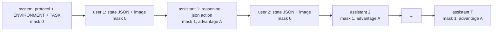
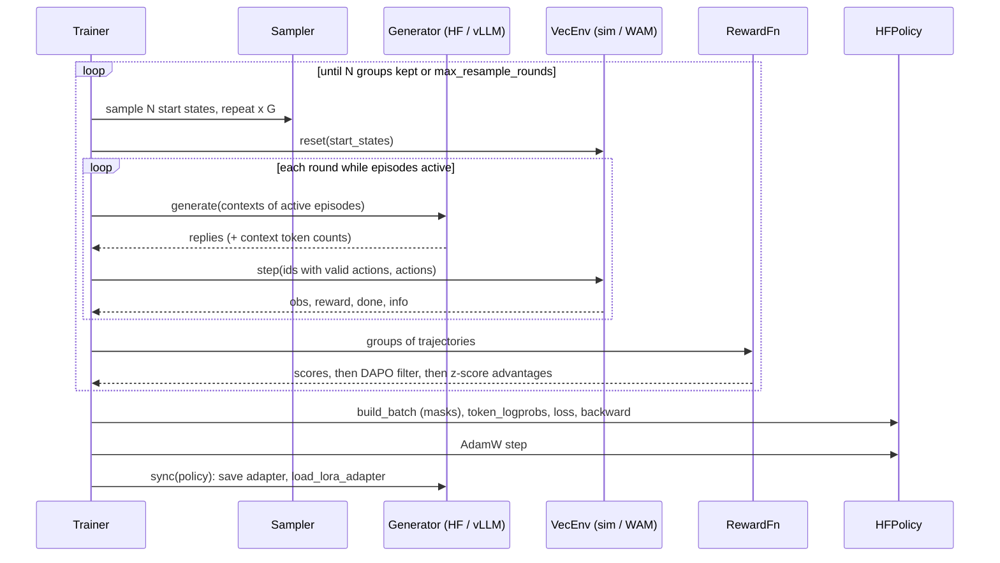

# Algorithm

What one call of `Trainer.collect()` + `Trainer.update()` computes. The paper-side derivation is in
[RL objective](../pear/objective.md).

## One step

1. **Collect.** Run N·G episodes (see [Rollouts](rollouts.md)). Compute scores = `RewardFn(groups)`.
2. **Filter** (`filter_groups`): keep group *g* iff \(\operatorname{std}_i s_{g,i} > 0\). Resample until N groups survive.
3. **Advantages** (`adv_mode`), per group:

    | mode | \(A_{g,i}\) |
    |---|---|
    | `zscore` (default, PEAR Eq. 1) | \((s - \bar s)/(\sigma_s + \epsilon)\) |
    | `center` | \(s - \bar s\) |
    | `rloo` | \(s_i - \operatorname{mean}_{j \neq i} s_j\) |

    The trajectory's advantage is broadcast to every response token of every round. Trajectories with
    \(A = 0\) are skipped, since they contribute zero gradient.
4. **Loss**, summed over all response tokens and divided **once** by the global token count \(N_{tok}\):

    \[
    L = -\frac{1}{N_{tok}} \sum_{\text{tokens}} A \,\big(\log \pi_\theta(y_t \mid c_t) - C_t\big)
    \]

    where \(C_t\) is the score-centering surrogate (below). With `policy_loss=ppo_clip`, the
    REINFORCE term is replaced by \(\min(rA, \operatorname{clip}(r, 1-\epsilon_{lo}, 1+\epsilon_{hi})A)\) with
    \(\epsilon_{lo}=0.2\) and \(\epsilon_{hi}=0.28\) (DAPO clip-higher).
5. **Update.** AdamW step with grad-norm clip 1.0, skipping non-finite losses or gradients.
   Then push the weights to the rollout engine (vLLM backend).

`ppo_epochs` (default 1, as in PEAR) repeats step 4–5 on the same batch.

## Score centering

PEAR's correction (Eq. 2) is \(-\mathbb{E}_{v\sim\mu}\nabla\log\pi_\theta(v\mid c)\), where \(\mu\) is the
policy that generated the batch. vlmrl uses the identity

\[
\mathbb{E}_{v\sim\mu}\nabla\log\pi_\theta(v) = \sum_v (\mu_v - \pi_{\theta,v})\,\nabla\log\pi_{\theta,v}
\]

(which holds because \(\sum_v \pi_{\theta,v}\nabla\log\pi_{\theta,v} = 0\)) and evaluates it on \(\mu\)'s
top-k tokens (`score_centering_topk`, default 32):

\[
C_t = \sum_{v \in \text{top-}k(\mu)} \big(\mu_v - \operatorname{sg}[\pi_{\theta,v}]\big) \log \pi_{\theta,v}
\]

- \(\nabla C_t \approx \mathbb{E}_\mu \nabla \log \pi_\theta\), and the only error is the tail mass outside the top-k.
- When \(\mu = \pi_\theta\), \(C_t\) has **exactly zero gradient for any k**.
- **When it's active:** with `ppo_epochs=1` every update is on-policy, so the term is zero and skipped.
  With `ppo_epochs>1`, \(\mu\)'s top-k ids and probabilities are snapshotted before the first update and
  used to correct every update. In an async setup, \(\mu\)'s top-k would come from the rollout engine.

Tests check that the gradient is zero on-policy and equals \(\mu - \pi\) (the expected score) with full support.

## Multi-turn loss masks, model-agnostic

For assistant message *k*:

```
start = len(tokenize(messages[:k],   add_generation_prompt=True))
end   = len(tokenize(messages[:k+1]))
mask[start:end] = 1
```

This covers the reply plus the template's end-of-turn token (so the model learns to stop), and never
covers prompts, images or the generation header. It relies on the chat template being
**prefix-stable**, which is asserted on the first batch. Templates that rewrite history need
`max_images=<int>` (see [Models](../models/index.md#prefix-stable-chat-templates)).



Responses are re-tokenized from text for training, as in most HF-based RL stacks. Tests check that
the masked tokens decode to exactly the replies, and that log-probs computed with `logits_to_keep`
match a naive full forward pass.

## Sequence diagram


