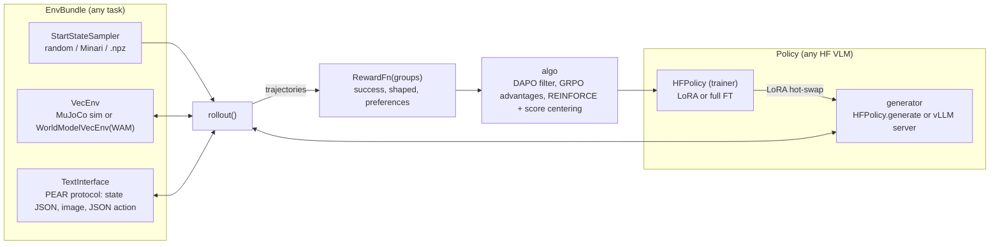

# Architecture

The trainer only ever sees five interfaces. Each is a `typing.Protocol`, so any object with the
right methods works and nothing needs to inherit from a base class.

| interface | methods | implementations |
|---|---|---|
| `VecEnv`: dynamics | `reset(start_states) -> [Obs]`, `step(ids, actions) -> [StepResult]`, `close()` | `PointMazeSimVecEnv`, `WorldModelVecEnv(wam)` |
| `TextInterface`: agent protocol | `system_prompt(s)`, `observation_message(obs, turn, last, parse_error)`, `parse_action(text)`, `noop_action()`, optional `format_action(a)` | `PointMazeTextInterface` (built on `envs/protocol.py`) |
| `StartStateSampler` | `sample(n, rng) -> [dict]` | `RandomStartSampler`, `OfflineStartSampler` |
| `RewardFn` | `groups: list[list[Trajectory]] -> list[list[float]]` | `rewards.build_reward(spec)` |
| generator | `generate(convs, max_new_tokens, temperature, top_p, batch) -> [str]`, `last_num_tokens` | `HFPolicy`, `VLLMServerGenerator` |

An environment is an `EnvBundle` that packages the first three plus `max_turns`.

## Design decisions

**Dynamics are separate from the text interface.** The same prompt, observation formatting and
action parser drive both the simulator and a world model, so the policy faces exactly the same
task either way. This is PEAR's "same protocol in sim and on the real robot" idea, applied to sim vs WAM.

**`step(ids, actions)` is slot-indexed.** Episodes end at different times. The rollout loop steps
only the unfinished slots, so a WAM does one batched forward pass over the active set.

**Rewards see whole groups.** GRPO compares the G rollouts that share a start state, so scalar
rewards and *relative* signals (preferences) have the same type. See [Rewards](rewards.md).

**The transcript is the source of truth.** `Trajectory.messages` holds the HF-format chat (PIL images
inline) exactly as the policy saw it. Training re-tokenizes it, so the rollout and training
contexts can't diverge.

## Data types

| type | fields |
|---|---|
| `Obs` | `image` (H×W×3 uint8), `state` (optional vector), `extras` (e.g. `goal`, `dist`) |
| `StepResult` | `obs`, `reward`, `terminated`, `truncated`, `info` |
| `Turn` | `obs` seen, `response` text, parsed `action` (None = invalid), `result` |
| `Trajectory` | `group_id`, `start_state`, `messages`, `turns`, `end_reason`, `score`, `advantage`; properties `success`, `env_return`, `num_invalid`, `frames` |
