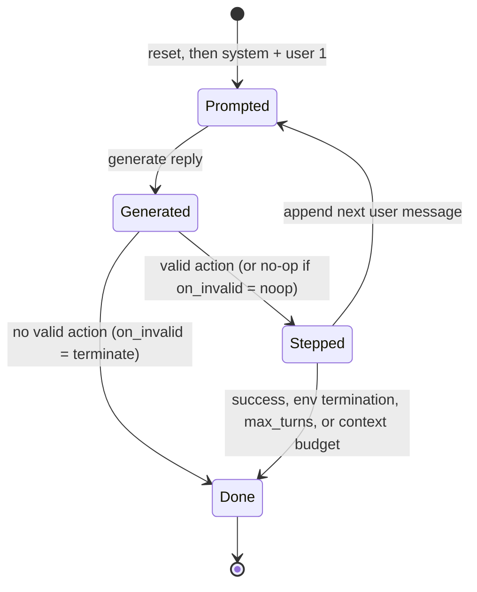

# Rollouts & episodes

`vlmrl.rollout.rollout(...)` runs `len(start_states)` episodes **in lock-step**. Each round:

1. Every unfinished episode's context goes to `generate` as **one batch**.
2. Replies are parsed by the `TextInterface`.
3. Episodes with a valid action are stepped in **one batched `env.step(ids, actions)`**.
4. Each episode either ends or gets its next user message (state JSON + image).

## Ways an episode ends

`Trajectory.end_reason` records which one fired. The trainer logs the fractions as
`rollout/end_*` and `eval/end_*`.

| `end_reason` | condition | config |
|---|---|---|
| `success` | the env reports success | — |
| `invalid` | the reply has no valid action (PEAR) | `on_invalid=terminate` (default); `noop` executes `noop_action()` instead and says so in the next message |
| `max_turns` | step limit | `env_kwargs.max_turns` |
| `context` | prompt + reply tokens reached the budget (PEAR) | `max_context_tokens` (generator token counts) |
| `terminated` / `truncated` | env-side termination without success / time limit | — |

On an `invalid` ending the state is unchanged. The last step info and the scalar obs extras (e.g. PointMaze's
`dist`) are carried into the final turn, so distance-based rewards still work.

## Context: full history vs a window

- **`max_images=null` (PEAR, default).** The whole episode stays in context. For training, the
  episode is **one sequence** and the loss covers every assistant turn.
- **`max_images=k`.** Only the last *k* images are kept and older ones become
  `[earlier image omitted]`, while the text history stays. Contexts now differ per turn, so each turn
  becomes its own training sample with **exactly** the view it was generated from
  (`rollout.context_view` is shared by rollout and training, and a test checks they match).
- **`max_frames=k`.** Only the system prompt and the last *k* rounds (each observation message and
  the replies after it) are kept, and older rounds are dropped entirely, text included. Each turn becomes its own
  training sample. `max_frames=1` turns every round into a short single-frame prompt, which is cheap and the
  right choice when the observation is **Markov**: PointMaze with `include_state=true`, where the
  ball is at rest after each action. `experiment=pointmaze_q3vl4b_vllm` sets it, but PEAR keeps the full
  history, so `experiment=pear_recipe` doesn't. `max_frames` and `max_images` compose: frames are cut first,
  then images.

## Groups

`Trainer.collect` samples N start states and repeats each G times, so the members of a group share
`group_id` and `start_state`. After rewards are computed, the DAPO filter drops groups with no
variance and fresh groups are sampled (up to `max_resample_rounds`) until N survive.
