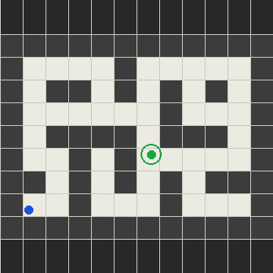
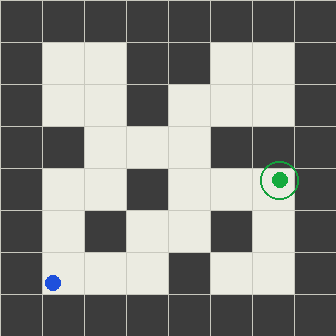

# PointMaze

`env=pointmaze` (`task=pointmaze`). Source: [`vlmrl/envs/pointmaze.py`](https://github.com/jesbu1/vlm-rl/blob/main/vlmrl/envs/pointmaze.py).

{ width="280" } { width="280" }

## Dynamics

gymnasium-robotics `PointMazeEnv`: a MuJoCo point mass with force actions in \([-1,1]^2\),
\(dt = 0.01\), and success when \(\lVert pos - goal\rVert \le 0.45\). This is the same physics that generated
the D4RL/Minari `pointmaze` datasets. `PointMazeSimVecEnv` keeps a pool of these and supports
**exact reset-to-state** (`{"qpos", "qvel", "goal"}` via `set_state` plus a goal-site update). Episodes
end on success (`continuing_task=False`).

## The robot, in PEAR terms

One part, `ball`, with settable quantities `x, y` (maze units; one cell = 1; x right, y up, (0, 0) at
the image centre). The action is the **change** `{"ball": {"x": dx, "y": dy}}`, clipped to length
`max_delta` (1.0). See [Prompts](prompts.md) for the full text.

## Execution: until reached and at rest

Following PEAR's EXECUTION section (`settle=true`, default), a PD controller (kp = 10, kd = 1) drives raw
forces toward `pos + delta` **until**:

| `info["stop"]` | condition |
|---|---|
| `reached` | ‖target − pos‖ < 0.05 **and** ‖v‖ < 0.1 |
| `blocked` | moved < 0.01 over the last 20 physics steps (e.g. pushing into a wall) |
| `success` | entered the goal radius (episode ends) |
| `steps` | hit the 200-substep cap |

A free 1-cell move settles in ≈42 substeps. With `settle=false`, every action runs exactly
`action_repeat` (40) substeps. The executed force sequence is returned as `info["low_level_actions"]`,
which is useful as world-model training data. `action_mode=force` (holding raw forces) exists for the
`simple` prompt style only.

## Observations

`render_topdown(maze_map, agent_xy, goal_xy, size)` is a **pure function of low-dimensional state**:
dark walls, light floor, a faint cell grid, a blue agent, and a green goal disc with its success-radius
ring. Offline datasets have no images, but they can be rendered identically, which you need in
order to train a WAM on Minari data. `Obs.extras` carries `goal` and `dist`.

## Options (`env_kwargs.*`)

| key | default | meaning |
|---|---|---|
| `maze` | `umaze` | `open`, `umaze`, `medium`, `large`, `open_diverse_gr`, `medium_diverse_gr`, `large_diverse_gr`; a procedural layout `gen<rows>x<cols>s<seed>`; or a procedural **family** `gen<rows>x<cols>` (layout split, below) |
| `max_turns` | 10 (task preset) | step limit per episode |
| `image_size` | 336 | rendered frame size (px) |
| `include_state` | true | state JSON in each turn and goal coordinates in the TASK; false = image-only |
| `prompt_style` | `pear` | `pear` (paper protocol), `simple` (`<action>{"dx","dy"}</action>`), or `compact` (small models, below) |
| `settle` | true | PEAR execution semantics (above) |
| `action_mode` | `delta` | `force` only with `prompt_style=simple` |
| `max_delta` | 1.0 | maximum move per action |
| `start_states` | `random` | `random`, a Minari id, or a `.npz` path |
| `eval_start_states` | `random` | same, for the fixed eval set |
| `min_goal_dist` | 1.5 | minimum start–goal distance |
| `split` | `none` | train / held-out split of random starts: `none`, `pair`, `goal` (below) |
| `holdout_frac` | 0.25 | fraction of start–goal cell pairs (`pair`) or goal cells (`goal`) held out of training |
| `split_seed` | 0 | which pairs / goal cells are held out |
| `eval_split` | `heldout` | part the eval sampler draws from: `heldout`, `train`, `all` (start–goal pairs with `split` ≠ `none`; layouts for a procedural family) |
| `train_mazes` | 64 | procedural family: training layouts are seeds `[0, train_mazes)` |
| `eval_mazes` | 16 | procedural family: held-out layouts are seeds `[10000, 10000 + eval_mazes)` |

## Small-model prompt (`prompt_style=compact`)

Models below ~1B parameters (SmolVLM-256M) do not follow the PEAR or simple formats: zero-shot on
`pointmaze_procgen` they are 100% invalid (echoing the state JSON, or prose). `compact` is a few-sentence
system prompt; each turn is the image followed by `Ball: x=.., y=... Goal: x=.., y=... Move:`, and the reply is
`{"x": dx, "y": dy}`, parsed leniently (the first `x` / `y` (or `dx` / `dy`) values anywhere in the reply).
With it, ~17–23% of SmolVLM-256M's turns parse zero-shot.

## Distances in `info`

Every step reports `dist` (Euclidean distance to the goal) and `geo_dist`: the shortest-path length in cells
(4-connected, through free cells, BFS from the goal once per episode) from the ball's cell to the goal's cell.
`geo_dist` respects walls, so it is the better distance for maze shaping (reward `neg_geo_dist`).

## Start states

- **`random`**: uniform over free cells (± 0.25 noise), zero velocity, at least `min_goal_dist` apart.
- **`D4RL/pointmaze/umaze-v2`** (any Minari id): random timesteps of offline trajectories, with their
  real velocities and the dataset's goal. `episode` and `t` are kept in the state dict so a WAM can
  look up the matching reference frames. Verified against the real UMaze dataset (13,210 episodes, 1M steps).
- **`path/to/file.npz`** with arrays `qpos [N,2]`, `qvel [N,2]`, `goal [N,2]`. Extra arrays pass through.

## Train / held-out split

By default, training and eval draw random starts from the same distribution: eval episodes are new
samples, but any start–goal combination can also show up in training. `split` partitions the
(start cell, goal cell) pairs (`vlmrl/envs/pointmaze.py::split_pairs`, deterministic given `split_seed`):

- **`pair`** holds out `holdout_frac` of the pairs. Every cell appears in training, but some
  start–goal combinations never do.
- **`goal`** holds out `holdout_frac` of the goal cells. Training never asks the ball to reach them.

The train sampler draws only from the train part. The eval sampler draws from `eval_split`. Position
noise stays inside the cell, so a held-out pair is never produced by the train part. Sizes at
`min_goal_dist=1.5`, `holdout_frac=0.25`:

| maze | `pair`: train / held-out pairs | `goal`: train / held-out pairs |
|---|---|---|
| umaze | 20 / 6 | 17 / 9 (2 of 7 goal cells) |
| medium | 411 / 137 | 424 / 124 |
| large | 1442 / 480 | 1420 / 502 |

## Procedural mazes and a layout split

The D4RL layouts are fixed and small (UMaze is solved within ~20 RL steps). `task=pointmaze_procgen` uses
**procedural mazes** instead, and splits them **by layout**:

- `gen<rows>x<cols>s<seed>` (odd sizes ≥ 5) is generated by `vlmrl/envs/pointmaze.py::generate_maze`. A
  recursive-backtracker spanning tree over the odd-indexed cells is carved first, then 15% of the remaining
  interior walls between two corridors are knocked out. The result has loops, i.e. several routes and fewer
  pure dead ends. It is deterministic in the seed, and every free cell is reachable.
- `maze: gen11x11` (a family, no seed) draws a **different layout per episode**. Training uses seeds
  `[0, train_mazes)`. The eval sampler uses the held-out seeds `[10000, 10000 + eval_mazes)`
  (`eval_split: heldout`), the training layouts (`train`), or both (`all`). Each start state carries its
  `maze` name. The VecEnv keeps **one MuJoCo simulator per layout**, shared by every slot on that layout: each
  slot stores its own (qpos, qvel, goal) and loads it into the simulator for its step. Building a MuJoCo env
  takes ~0.1 s, so this builds each layout once instead of one env per episode (a step of ~1000 episodes
  used to spend ~100 s in `reset`); at most `max_sims` (256) idle simulators are kept, least recently used
  closed first. (Formerly: pooled per-slot envs, an env was rebuilt only when a slot's
  layout changes, and idle envs are capped). The prompt's ENVIRONMENT section and the rendered image follow
  the episode's layout.
- Paths are tens of cells long, so the preset allows moves of up to 3 cells (`max_delta: 3.0`) and 20 rounds,
  with starts ≥ 3 cells from the goal.

```
###########      ###########
#.....#...#      #.........#
#####.#.#.#      #.###.###.#      gen11x11s0 and gen11x11s1
#.....#.#.#      #.......#.#      (# wall, . floor)
#.###.#.#.#      #########.#
#...#.#.#.#      #.....#...#
#.#.#.#.#.#      #.#####.#.#
#.......#.#      #.#.....#.#
#.#######.#      #.#.###.#.#
#.....#...#      #.......#.#
###########      ###########
```

`experiment=pointmaze_procgen` trains on the 64 layouts and evaluates three [eval sets](#eval-sets-in-and-out-of-distribution)
in one pooled rollout:

```yaml
eval_sets:
  id_layouts:  {eval_split: train}                                 # training layouts, new episodes
  ood_layouts: {eval_split: heldout}                               # 16 held-out 11x11 layouts
  ood_larger:  {maze: gen15x15, eval_split: heldout, max_turns: 30} # held-out, larger than any training layout
```

A procedural family already splits by layout, so `split` (start–goal pairs within one maze) must stay `none`
there.

## Eval sets (in and out of distribution)

`eval_sets` names several eval environments. Each one is a set of `env_kwargs` overrides plus an optional
`episodes` count (default `eval_episodes`), for example `experiment=pointmaze_generalization`:

```yaml
env_kwargs: {maze: umaze, split: goal}           # training: UMaze, 2 of 7 goal cells held out
eval_sets:
  id:         {eval_split: train}                # in distribution: new episodes, goal cells seen in training
  ood_goals:  {eval_split: heldout}              # held-out goal cells
  ood_medium: {maze: medium, eval_split: all, max_turns: 20}   # unseen layout
```

From the command line: `+eval_sets.ood_medium.maze=medium +eval_sets.ood_medium.eval_split=all`.

- Each set gets its own env, prompt and fixed start states, drawn once from its eval sampler.
- **Pooled:** all sets run in one rollout loop (`vlmrl/rollout.py::rollout_pooled`). Each round, the
  unfinished episodes of every set go into a single generation call, so vLLM batches across sets. Each set
  then steps its own env, which is batched over that set's active episodes.
- **Logging:** `eval/<name>/{success,turns,invalid_frac,end_*}` per set, and `eval/success` etc. as the
  unweighted mean over sets (overall success = mean of the per-set success rates). Media per set:
  `eval/<name>/episode` (video), `eval/<name>/transcript`, `eval/<name>/samples`.
- Without `eval_sets`, there is one eval set built from `env_kwargs`, logged as `eval/*` as before.

## Oracle and difficulty

`oracle_delta(maze_map, pos, goal, max_delta)` runs BFS over cells and aims at the furthest cell centre of
the current straight run of the shortest path that is within `max_delta` (with `max_delta=1`, the next cell).
Through the text protocol, over 30 rounds:

| maze | oracle success / mean rounds | random-waypoint success |
|---|---|---|
| umaze | 1.00 / 3.8 | 0.25 |
| medium | 1.00 / 6.1 | 0.12 |
| large | 1.00 / 8.9 | 0.00 |

Procedural mazes (`max_delta=3`, starts ≥ 3 cells from the goal, 64 episodes each; random = uniform moves in
[-3, 3]²):

| eval set | oracle success / mean rounds | random-move success |
|---|---|---|
| gen11x11, training layouts (20 rounds) | 1.00 / 6.3 | 0.05 |
| gen11x11, held-out layouts (20 rounds) | 1.00 / 6.0 | 0.08 |
| gen15x15, held-out layouts (30 rounds) | 1.00 / 7.9 | 0.08 |

UMaze saturates quickly under RL (see the [experiment log](../training/experiments.md)). `medium` and
`large` are where differences between models and rewards show up.
