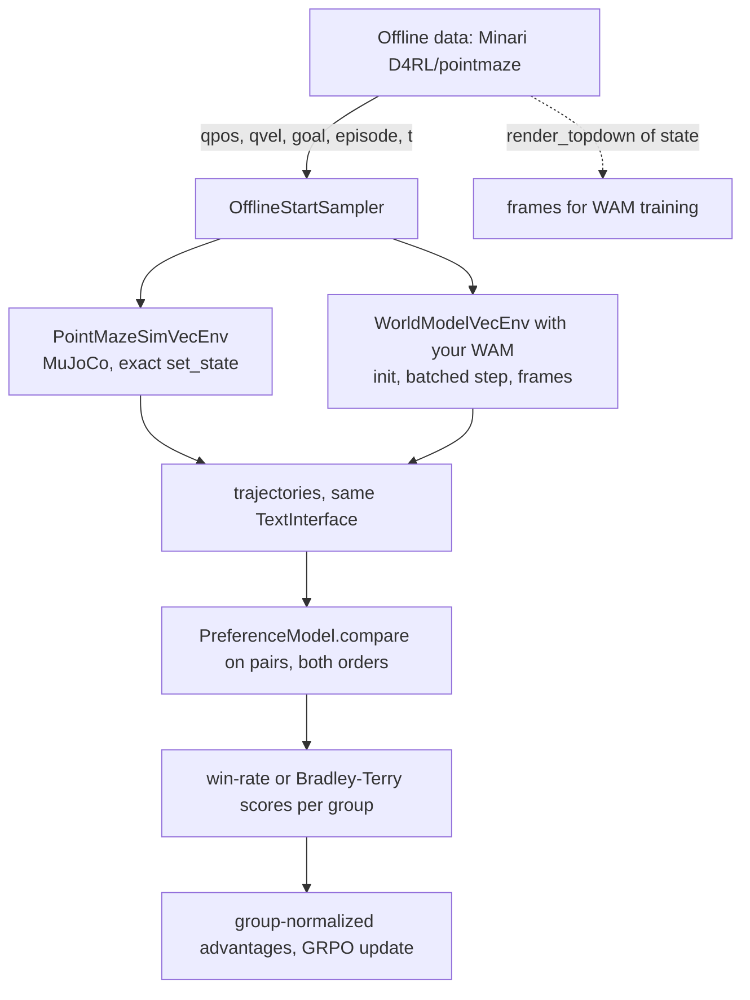

# World-action models

A learned world(-action) model can replace the simulator **without changing anything else**. The
policy sees the same `TextInterface`, start states can come from the same offline data, and
rewards can come from the WAM's own preference judgments.

## Implement three batched methods

```python
class MyWAM:
    def init(self, start_states):          # offline reference states -> model states (e.g. encoded frames)
        frames = [render_topdown(MAZE, s["qpos"], s["goal"]) for s in start_states]   # or dataset frames
        return self.encode(frames)

    def step(self, states, actions):       # actions: [B, 2] parsed JSON actions
        nxt = self.dynamics(states, actions)
        return nxt, self.decode(nxt), {"done": self.done_head(nxt)}    # optional: reward / success / state

    def render(self, states):
        return self.decode(states)
```

and wrap it:

```python
from vlmrl.envs.base import EnvBundle
from vlmrl.envs.pointmaze import OfflineStartSampler, PointMazeTextInterface, get_maze_map
from vlmrl.envs.world_model import WorldModelVecEnv

maze_map = get_maze_map("umaze")
bundle = EnvBundle(
    make_vec_env=lambda: WorldModelVecEnv(MyWAM(...), carry_keys=("goal",)),
    interface=PointMazeTextInterface(maze_map, include_state=False),     # same PEAR protocol as the sim
    train_sampler=OfflineStartSampler("D4RL/pointmaze/umaze-v2"),
    eval_sampler=OfflineStartSampler("D4RL/pointmaze/umaze-v2"),
    max_turns=10)
```

`WorldModelVecEnv` handles slot bookkeeping, and only active slots are passed to `step`, as one batch.
`extras` may contain per-item `reward`, `done` (bool or probability, thresholded at `done_threshold`),
`success`, and `state` (a low-dim estimate that the interface can verbalize). `carry_keys` copies
start-state fields (e.g. `goal`) into every `Obs.extras`.

## Rewards from the WAM

```python
from vlmrl.rewards import preference_reward

class WAMPreference:
    def compare(self, pairs):                       # [(traj_a, traj_b), ...] -> P(a ≻ b), batched
        return self.wam.prefer([a.frames for a, _ in pairs], [b.frames for _, b in pairs])

reward_fn = preference_reward(WAMPreference(wam), mode="winrate")      # or "bt"
Trainer(cfg, bundle=bundle, reward_fn=reward_fn).train()
```

Expose it to the CLI as a factory: `env=my_pkg.wam:make_bundle reward=my_pkg.wam:make_reward`.
See [Rewards & preferences](../concepts/rewards.md) for how pairs become scores.

## A runnable stand-in

[`examples/toy_wam.py`](https://github.com/jesbu1/vlm-rl/blob/main/examples/toy_wam.py) is a kinematic
"WAM" (position += clipped delta, walls ignored) plus a progress-based preference head.

```bash
python scripts/train.py experiment=toy_wam_prefs      # Minari start states + preference rewards
```

It was verified to train with Qwen3-VL-4B (a real update step: 210 s rollout, 77 s train).



!!! tip "Keep sim and WAM tasks identical"
    If your WAM can't predict low-dim state, use `include_state=false` in the simulator too, so the
    policy you train or evaluate in sim faces the same image-only task as in the WAM.
