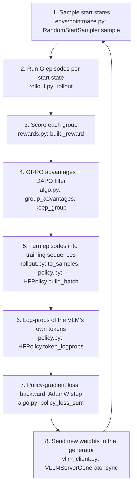
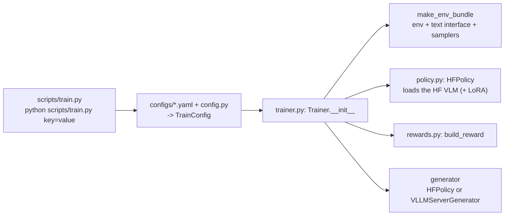

# Code tour

This page follows **one training step** through the code, in the order it runs. Every reference has the
form *file.py::function*. Open that file and search for the name. (A test checks that every reference on
this page still exists, so the page stays in sync with the code.)

## The whole library on one screen

```
scripts/train.py            the CLI: reads the Hydra config, builds a Trainer, calls train()
vlmrl/
  trainer.py                THE MAIN LOOP: collect rollouts -> rewards -> GRPO update -> eval/log/save
  rollout.py                multi-turn episodes: ask the VLM, parse its action, step the env, repeat
  algo.py                   THE GRPO MATH: advantages, group filter, policy loss, score centering
  policy.py                 the VLM: sampling replies, tokenizing chats, per-token log-probs, LoRA
  rewards.py                turn finished episodes into scores (success, shaped, preferences)
  vllm_client.py            optional fast generation through a vLLM server
  config.py                 Hydra glue (TrainConfig in trainer.py is the schema)
  types.py                  data classes: Obs, StepResult, Turn, Trajectory
  envs/
    base.py                 the interfaces any environment implements
    protocol.py             PEAR's prompt protocol (system prompt, state JSON, action parser)
    pointmaze.py            the PointMaze environment
    world_model.py          adapter that makes a learned world model look like an environment
configs/                    YAML presets: policy/ (which VLM), task/ (which env), rollout/, experiment/
```

The three files to read first are **`trainer.py`** (what happens), **`algo.py`** (the RL math) and
**`rollout.py`** (how episodes run). Everything else plugs into them.

## One training step, in order



Steps 1–4 are `trainer.py::Trainer.collect`. Steps 5–7 are `trainer.py::Trainer.update`. The loop
around them, plus eval, logging and checkpointing, is `trainer.py::Trainer.train`.

### 1. Sample start states

`trainer.py::Trainer.collect` asks the environment's sampler for N start states and repeats each one G
times, so the G episodes of a **group** all start from the same state. For PointMaze, the samplers are
`pointmaze.py::RandomStartSampler` (random cells) and `pointmaze.py::OfflineStartSampler` (states from
D4RL/Minari data).

### 2. Run the episodes

`rollout.py::rollout` runs all N·G episodes in lock-step. Each round:

1. Build each episode's chat (system prompt + history), trimmed by `rollout.py::context_view` if
   `max_frames` / `max_images` is set.
2. **Ask the VLM**: `policy.py::HFPolicy.generate`, or `vllm_client.py::VLLMServerGenerator.generate` with the vLLM backend.
3. **Parse the reply**: `pointmaze.py::PointMazeTextInterface.parse_action`, which calls
   `protocol.py::parse_action` to read the fenced JSON block.
4. **Step the environment**: `pointmaze.py::PointMazeSimVecEnv.step` runs the PD controller in MuJoCo
   until the ball reaches the target and stops.
5. Append the next observation (state JSON + image), built by `pointmaze.py::PointMazeTextInterface.observation_message`.

Episodes end on success, the turn limit, the context budget, or an invalid action. Each finished
episode is a `types.py::Trajectory`. See [Rollouts & episodes](../concepts/rollouts.md).

### 3. Score each group

`trainer.py::Trainer.collect` calls the reward function on whole groups. `rewards.py::build_reward`
turns a spec like `success+0.5*neg_dist` into that function. Preferences come from
`rewards.py::preference_reward`. See [Rewards & preferences](../concepts/rewards.md).

### 4. GRPO advantages and the DAPO filter

The core of GRPO is in **`algo.py`**:

- `algo.py::group_advantages`: \(A_i = (s_i - \text{mean}) / (\text{std} + \epsilon)\) within each group (PEAR Eq. 1).
- `algo.py::keep_group`: drop groups where every episode scored the same (no signal), then
  `trainer.py::Trainer.collect` samples replacement groups.

### 5. Build training sequences

`trainer.py::Trainer.update` turns each kept episode into training samples with `rollout.py::to_samples`
(one sequence per episode, or one per turn when the context was trimmed). `policy.py::HFPolicy.build_batch`
tokenizes them and builds the **loss mask**, which is 1 only on the tokens the VLM generated.

### 6. Log-probabilities

`policy.py::HFPolicy.token_logprobs` runs the VLM forward pass and returns \(\log \pi_\theta\) of every
generated token, using `policy.py::chunked_token_logprobs` so the full vocabulary is never held in fp32.

### 7. The loss and the update

`algo.py::policy_loss_sum` computes the REINFORCE loss \(-A \cdot \log \pi_\theta\) summed over tokens
(optionally PPO-clip, optionally with `algo.py::score_centering_term`). `trainer.py::Trainer.update`
divides by the total number of generated tokens, backpropagates, clips the gradient norm and takes one
AdamW step. See [Algorithm](../concepts/algorithm.md) for the exact equations.

### 8. Sync and repeat

With the vLLM backend, `vllm_client.py::VLLMServerGenerator.sync` saves the LoRA adapter and loads it into
the server, so the next rollouts use the new weights. `trainer.py::Trainer.train` then logs metrics
(`trainer.py::Trainer.log`), writes episode videos and transcripts (`trainer.py::Trainer.log_episodes`),
runs eval (`trainer.py::Trainer.evaluate`), and saves a resume checkpoint (`trainer.py::Trainer.save_resume`).

## How the trainer gets built



`trainer.py::make_env_bundle` looks up the environment (e.g. `pointmaze.py::make_pointmaze`), which returns
an `base.py::EnvBundle` holding the dynamics (`base.py::VecEnv`), the prompt/parser
(`base.py::TextInterface`) and the start-state samplers.

## If you want to change X, edit Y

| you want to… | edit |
|---|---|
| change the RL algorithm (advantages, loss, filter) | `algo.py` (`algo.py::group_advantages`, `algo.py::policy_loss_sum`) |
| change the training loop or what gets logged | `trainer.py::Trainer.train`, `trainer.py::Trainer.update` |
| change what the VLM sees or how its reply is parsed | `pointmaze.py::PointMazeTextInterface` (built on `protocol.py::system_prompt`) |
| change the maze physics or controller | `pointmaze.py::PointMazeSimVecEnv.step` |
| add a reward | `rewards.py::build_reward` (or pass `reward=my.module:factory`) |
| add an environment | write an `base.py::EnvBundle` factory; see [Adding an environment](../environments/adding.md) |
| plug in a world model | `world_model.py::WorldModelVecEnv`; see [World-action models](../environments/world-models.md) |
| use a different VLM | a YAML file in `configs/policy/`; see [Adding a model](../models/adding.md) |
| change a default setting | `trainer.py::TrainConfig` (all fields: [reference](../reference/config.md)) |
| change how episodes end | `rollout.py::rollout` |
| run on SageMaker | `sagemaker_submit.py::build_request`, `job_entry.py::main`; see [SageMaker](../training/sagemaker.md) |
| run on parallel GPU machines | `batch_submit.py::submit_request`, `job_entry.py::S3Syncer`; see [AWS Batch](../training/batch.md) |
