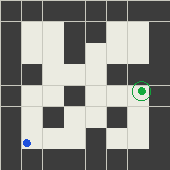

# Quickstart

Everything on this page runs on a laptop CPU.

## 1. Tests

```bash
make test        # 157 fast tests (~10 s)
make test-slow   # + 6 tests that load SmolVLM-256M (downloads ~500 MB once)
```

## 2. See the environment

A BFS oracle drives PointMaze **through the text protocol**, the same way a VLM would: it writes
JSON actions, the parser reads them and the controller executes them.

```bash
make demo        # = python scripts/demo_pointmaze.py --maze medium --policy oracle
```

This writes `outputs/demo/medium_oracle.gif` and `outputs/demo/prompt.txt`, the exact prompt the
policy sees (also shown on the [Prompts](../environments/prompts.md) page).

{ width="280" }

## 3. One RL step with a tiny VLM

```bash
make smoke       # = python scripts/train.py experiment=smoke
```

This runs one GRPO step on SmolVLM-256M: rollouts, rewards, advantages, a gradient step, an eval,
and an MP4 + transcript in `runs/smoke/episodes/`. The 256M model can't follow the action format
(so the smoke config uses `on_invalid=noop` and a dense reward). It only checks the plumbing.

## 4. Look at what you can configure

```bash
python scripts/train.py --cfg job                          # the resolved default config
python scripts/train.py --cfg job experiment=pear_recipe   # the paper's Table 1 settings
```

Next: [Your first real run](first-run.md), or read how [PEAR](../pear/index.md) works.
