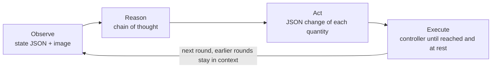

# vlmrl

**Minimal multi-turn VLM reinforcement learning, PEAR-style, for any Hugging Face VLM, any
environment and any reward.**

vlmrl is a small (~1.8k-line), readable reproduction of the training recipe from
[PEAR: *Training Reasoning Models in Simulation to Natively Use Real Robots*](https://arxiv.org/abs/2611.18562)
(MIT HAN Lab). A vision-language model is the policy. Each round it sees the state and camera
images, reasons in text, and writes a JSON action. It is trained with GRPO from task outcomes alone.

- **New here?** Start with the [Quickstart](getting-started/quickstart.md), then
  [your first real run](getting-started/first-run.md).
- **Want to understand PEAR?** Read [the paper, explained](pear/index.md): the
  [protocol](pear/protocol.md), the [objective](pear/objective.md), the [recipe](pear/recipe.md).
- **Bringing your own world model?** See [World-action models](environments/world-models.md) and
  [Rewards & preferences](concepts/rewards.md).
- **Picking a VLM?** Every supported model has [its own page](models/index.md).

## What it gives you

| | |
|---|---|
| **Any HF VLM** | Anything loadable with `AutoModelForImageTextToText` whose processor has a chat template. Presets for [Qwen3-VL](models/qwen3-vl-4b.md), [Qwen2.5-VL](models/qwen2.5-vl-3b.md) and [SmolVLM2](models/smolvlm2-2.2b.md). |
| **Any environment** | Three swappable pieces (dynamics, text protocol, start states), so a MuJoCo simulator and a learned world-action model are interchangeable. See [Architecture](concepts/architecture.md). |
| **Any reward** | Success, shaped scalars, or pairwise **preferences**, all as one `groups -> scores` function. See [Rewards](concepts/rewards.md). |
| **PointMaze for VLM-RL** | MuJoCo dynamics matching the D4RL/Minari datasets, PEAR's prompt protocol, and exact reset-to-state from offline data. See [PointMaze](environments/pointmaze.md). |
| **Two rollout backends** | In-process HF `generate`, or a vLLM server with prefix caching and LoRA hot-swap (≈9× faster evals). See [Backends](training/backends.md). |
| **Hydra configs, sweeps, wandb** | A type-checked config schema, a reward × model sweep runner, wandb reports. See [Training](training/index.md). |

## Status

!!! success "Verified"
    On 2×A6000 with Qwen3-VL-4B + LoRA (HF and vLLM backends, wandb logging), PointMaze UMaze eval
    success went **0.625 → 1.0 within 20 RL steps**. See the [experiment log](training/experiments.md).
    145 tests (139 fast CPU + 6 real-VLM) pass locally and on the GPU machine. See [Testing](development/testing.md).

