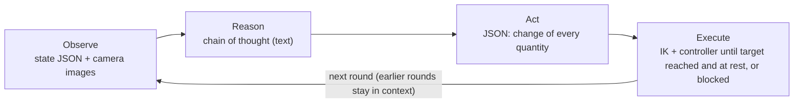

# PEAR, explained

*Training Reasoning Models in Simulation to Natively Use Real Robots*: Jiaming Tang, Zhuoyang Zhang,
Junxian Guo, Fangzhou Zhao, Yilong Zhao, Zekai Li, Xingyang Li, Yuyang Zhao, Song Bian, Zhijian Liu,
Song Han (MIT, UC Berkeley, UCSD, NVIDIA, Inco AI), November 2026.
[arXiv:2611.18562](https://arxiv.org/abs/2611.18562) ·
[blog](https://mit-han-lab.github.io/pear-blog/) · [code](https://github.com/mit-han-lab/pear) ·
[weights](https://huggingface.co/collections/mit-han-lab/pear)

This section summarizes the paper precisely, and is the reference vlmrl is built against.

## The idea: a robot-use agent

A **computer-use agent** observes a screenshot, reasons, and outputs a click or keystroke that the
operating system executes. PEAR's **robot-use agent (RUA)** does the same with a robot:

1. **Observe**: the robot's state as JSON plus camera frames.
2. **Reason**: a chain of thought, in text.
3. **Act**: the next end-effector pose, as a JSON *change* of every quantity.
4. **Execute**: inverse kinematics and the robot's own controller move there. Then the next
   observation arrives.

There are **no perception tools, grasp or motion planners, or skill libraries**. The model must
localize objects in the images itself, decide how to manipulate them, and recognize when a move
failed. The instruction and **all earlier rounds stay in the context**, so every decision can use the
whole episode.

## Why it transfers

Actions are pose-level targets and the controller sits outside the model, so **the protocol is
identical for every robot**. Only the list of parts and the description of the frame and cameras
change. A model trained only in simulation (LIBERO's single-arm Franka, RoboDojo's dual-arm ARX)
can therefore be deployed zero-shot on a real dual-arm YAM it never saw, and it succeeds in 18/30
trials (the base model: 0/30).

## How it's trained: robot-use RL (RURL)

Like computer-use agents, the model learns entirely by **reinforcement learning in simulation**,
from **binary task success**, with no demonstrations and no SFT. The authors avoid SFT because they
lacked in-distribution data and were concerned it would erode general capabilities. Training is
GRPO with DAPO's group filter, a REINFORCE loss without clipping, and score centering to correct
for asynchronous rollouts. It follows a curriculum because the base model almost never succeeds at first.

## Read on

| page | what's in it |
|---|---|
| [The robot-use protocol](protocol.md) | the exact system prompt, observation/action JSON, execution semantics, episode endings |
| [RL objective](objective.md) | Eq. 1 (advantages), Eq. 2 (gradient with score centering), the DAPO filter, with derivations |
| [Training recipe & systems](recipe.md) | Table 1, the curriculum, veRL/LMCache/FSDP×SP, why episodes are 94k tokens |
| [Results](results.md) | LIBERO, robustness, zero-shot transfer, sim-to-real, general capabilities, limitations |
| [PEAR ↔ vlmrl](mapping.md) | which paper element maps to which config key and code path |
