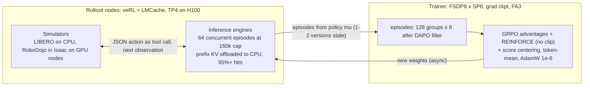

# Training recipe & systems

## Table 1: training setup

| Setting | Value |
|---|---|
| Base model | Qwen3.8-27B (open-weight reasoning VLM); reasoning effort **xhigh** in every rollout |
| RL algorithm | GRPO + DAPO group filter + score centering; REINFORCE loss in bypass mode, without PPO clipping |
| Batch | 128 groups of 8 rollouts per step, counted after the group filter |
| Optimization | AdamW, lr \(10^{-6}\), **one update per step**, token-mean loss, **no KL penalty, no entropy bonus** |
| Sampling | temperature 1.0 over the full distribution |
| Curriculum | see below |
| Max sequence length | 256k tokens on LIBERO, 160k on RoboDojo |
| Framework | veRL, fully asynchronous |
| Rollout | veRL + LMCache. H100: tensor parallelism 4; 64 rollouts per engine at a 160k cap, 32 at 256k; 95%+ prefix-cache hits. GB300: TP2, without LMCache |
| Training | H100: FSDP over 8 GPUs × 8-way sequence parallelism (FSDP8 × SP8), 32,512 tokens per GPU, FlashAttention-3, activation offloading. GB300: FSDP4 × SP4, 69,632 tokens per GPU, FlashAttention-4. Gradient checkpointing throughout; one FSDP group per node; InfiniBand between nodes |
| Simulators | LIBERO rendered on the CPUs of the rollout nodes; RoboDojo in Isaac containers on separate GPU nodes |
| Total compute | ≈ 50,000 H100-equivalent GPU-hours |

## Curriculum

| steps | tasks |
|---|---|
| 1 – 148 | LIBERO Goal, Spatial, Object |
| 149 – 225 | all four LIBERO suites (adds LIBERO-Long). The checkpoint at 225 is the "LIBERO-only" model |
| 226 – 340 | RoboDojo `general_pickup` and `align_blocks` (the two tasks with the strongest signal after LIBERO) |

LIBERO-Long is left out of the first stage on purpose. It's a clean test of transfer: at step 148 the
model already solves 39.0% of LIBERO-Long (base: 0.4%), and once LIBERO-Long is added it reaches 53.2%.

## Why the systems look like this

**Episodes are long.** On average an episode is ≈ **94k tokens** (1.8k prompt + 92k response) over
19.7 rounds with 39–59 images. Episodes shrink as training proceeds, from 119k tokens / 19.9 rounds
at the start to 82k / 18.5 at the end.

**Every round re-sends the whole context.** Most of each request is a prefix the engine has
already processed. That's why PEAR uses LMCache to **offload the prefix KV cache to CPU memory**, and
caps the number of concurrent rollouts (64 at 160k, 32 at 256k) so the **prefix-cache hit rate stays
≥ 95%**. GB300 nodes skip LMCache because their host memory is too small to act as an offload tier.
An H100 node (8 GPUs) and a GB300 node (4 GPUs) each generate about 2,000–3,000 tokens/s during
rollout. Multi-token prediction was disabled because of bugs.

**A whole episode is one training sequence.** Fitting 256k-token sequences needs FSDP × sequence
parallelism + gradient checkpointing (+ activation offload on H100).

**Asynchrony needs a correction.** Rollouts and updates overlap, so episodes come from a policy 1–2
versions old. Score centering fixes this mismatch without importance sampling (see [Objective](objective.md)).

## Inference after training

Reasoning length drives success. At low effort the LIBERO-only model uses 0.86k thinking tokens per
round (vs 3.23k at xhigh) and succeeds 21.9% of the time vs 74.4%. With NVFP4 weights and a DFlash2
drafter it decodes 52 tok/s on an M5 Max, 221 tok/s on an RTX 5090 and 747 tok/s on a GB300. An
xhigh round takes about 4.3 s. NVFP4 lowers accuracy, so all reported evaluations use BF16 weights.
