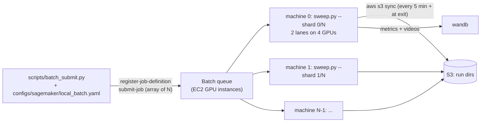

# AWS Batch (GPU containers)

Run a [sweep](sweeps.md) on an **AWS Batch job queue backed by EC2 GPU instances** (ECS), split over several
machines **in parallel**. It uses the same Docker image as [SageMaker](sagemaker.md). Use it when a plain GPU
queue has capacity and the SageMaker queues don't.



- **Sharding:** the sweep's runs are dealt round-robin over N machines. The job is one Batch **array job**,
  and child *i* runs `sweep.py --shard i/N` (`scripts/sweep.py::select`). Each machine trains `gpus // 2`
  runs side by side ([lanes](sweeps.md)): trainer on GPU 2*k*, its vLLM server on GPU 2*k*+1. By default N is
  chosen so every run gets its own lane, so the whole sweep runs at once.
- **The container** starts `docker/entrypoint.sh train` → `scripts/job_entry.py::main`. Without SageMaker's
  hyperparameters file, it reads `VLMRL_SWEEP`, `VLMRL_LANES`, `VLMRL_SHARDS`, `VLMRL_OVERRIDES`,
  `VLMRL_GROUP`, `VLMRL_ONLY` and `VLMRL_S3_OUTPUT` from the environment, and the shard from
  `AWS_BATCH_JOB_ARRAY_INDEX`. It downloads only the models of its own shard.
- **Outputs and resuming:** Batch has no checkpoint sync, so `scripts/job_entry.py::S3Syncer` restores
  `<s3_output>/<job>/` into the run dirs at start, uploads them every `VLMRL_SYNC_EVERY` seconds (300), and
  uploads once more at exit. A retried child picks up its runs' `resume/state.pt` and continues.
  **Each machine syncs only its own runs** (`<group>/<run>/*` for the runs of its shard, plus its own
  `vllm_*_shard<i>_*` logs; `scripts/job_entry.py::own_paths`). The machines share one S3 prefix. Syncing the
  whole prefix would make a machine that starts later restore early copies of other machines' runs, then upload
  those stale copies over the newer files. That happened in the first full sweep (fixed since).

## One-time setup

```bash
cp configs/sagemaker/example_batch.yaml configs/sagemaker/local_batch.yaml   # git-ignored; fill it in
aws ecr create-repository --repository-name <ecr_repository> --profile <profile> --region <region>
```

| key | what |
|---|---|
| `profile`, `region`, `queue` | AWS CLI profile, region, and the Batch job queue (EC2 compute environment with GPU instances) |
| `ecr_repository` | image repository in that account; images are tagged with the git commit |
| `job_role_arn` | the container's AWS identity; needs `s3:PutObject/GetObject/ListBucket` on `s3_output` |
| `execution_role_arn` | pulls the image and writes logs (e.g. a role with `AmazonECSTaskExecutionRolePolicy`) |
| `s3_output` | run dirs are synced to `<s3_output>/<job-name>/` |
| `gpus`, `vcpus`, `memory_mib` | per machine; must fit one instance type of the compute environment (e.g. g6e.12xlarge: 4 GPUs, 48 vCPUs) |
| `shm_mib` | `/dev/shm` size; vLLM needs far more than Docker's 64 MB default |
| `max_hours`, `retry_attempts` | per-machine time limit; Batch retries (retried children resume from S3) |
| `tags`, `env`, `secret_env` | as for [SageMaker](sagemaker.md#one-time-setup); tags are propagated to the instances |

## Build, push, submit

The image is built from the committed tree, as for SageMaker. Push it to the Batch account's registry:

```bash
IMAGE=$(python scripts/batch_submit.py --image)
aws ecr get-login-password --profile <profile> --region <region> | ssh <box> docker login --username AWS --password-stdin ${IMAGE%%/*}
ssh <box> "cd <checkout at this commit> && docker/build.sh $IMAGE" && ssh <box> docker logout ${IMAGE%%/*}

export WANDB_API_KEY=...
python scripts/batch_submit.py configs/sweeps/batch_small_fft.yaml --dry_run      # job definition + request
python scripts/batch_submit.py configs/sweeps/batch_small_fft.yaml \
    --group small-fft-smoke --set steps=2 --set eval_every=1 --set eval_episodes=8 --max_hours 2   # smoke test
python scripts/batch_submit.py configs/sweeps/batch_small_fft.yaml                # 8 runs on 4 machines at once
```

| flag | |
|---|---|
| `--shards N` | machines (default: ceil(#runs / lanes)) |
| `--lanes L` | lanes per machine (default `gpus // 2`) |
| `--only REGEX` | only runs whose name matches, e.g. `--only qwen3vl2b` |
| `--gpus`, `--vcpus`, `--memory_mib` | machine size for this submit (overrides the config), e.g. 1-GPU machines |
| `--gpus_per_lane 1` | trainer and vLLM server share one GPU (default when `gpus=1`) |
| `--set`, `--group`, `--max_hours`, `--tag`, `--dry_run` | as for `scripts/sagemaker_submit.py` |

Every submit registers a new revision of the job definition (`<ecr_repository>-gpu<gpus>`) pointing at the
image tag. Old revisions keep working for jobs that are still queued.

## 1-GPU machines

If the multi-GPU instance type has no capacity (Batch keeps the job RUNNABLE, and the auto-scaling group logs
`InsufficientInstanceCapacity`), submit to 1-GPU instances of the same queue. Every run then gets its own machine:

```bash
# small models: trainer + vLLM server on the same GPU (server capped at vllm_gpu_util_shared, default 0.3)
python scripts/batch_submit.py configs/sweeps/batch_small_fft.yaml --gpus 1 --vcpus 16 --memory_mib 120000 \
    --only 'minicpmv46|smolvlm256m'
# ~2B full fine-tuning needs most of a 48 GB GPU: generate in-process instead of a server
python scripts/batch_submit.py configs/sweeps/batch_small_fft.yaml --gpus 1 --vcpus 16 --memory_mib 120000 \
    --only 'qwen3vl2b|smolvlm2_2b' --set rollout=hf
```

On a shared GPU, the server starts first and takes its fraction; the trainer gets the rest. 16 vCPUs / 120 GB
selects `g6e.4xlarge` or larger. Full-FT resume state is ~12 bytes per parameter in CPU memory while it is written.

## Your own multi-GPU queue

A shared queue often allows only one availability zone or only small instances. Our own compute environment, in the
same VPC and with the same instance role, scales to zero when idle:

1. A security group with no inbound rules and all outbound traffic (instances reach S3, ECR, HF and wandb through the
   private subnets' NAT gateways).
2. A launch template whose user data formats and mounts the instance's **NVMe instance store at `/scratch`**
   (MIME-multipart shell script: `mkfs.xfs` on the first `Instance Storage` device, `mount /scratch`). g6e.12xlarge
   has 3.8 TB. Without it, containers only get the AMI's small root volume (~8 GB free) and RAM-backed `/dev/shm`.
3. A managed EC2 compute environment: `minvCpus: 0`, the GPU instance types you want (e.g. g6e.12xlarge /
   24xlarge = 4 GPUs, 48xlarge = 8), **private subnets in several availability zones** (on-demand capacity of one
   type in one zone runs out often), `ec2Configuration: [{imageType: ECS_AL2023_NVIDIA}]`, the launch template.
   Attaching a launch template later is an infrastructure update: pass
   `--update-policy terminateJobsOnUpdate=false,jobExecutionTimeoutMinutes=360` so running jobs are not cut off.
4. A job queue on it, plus a `queues.<name>` entry in `local_batch.yaml` (`gpus`, `vcpus`, `memory_mib`,
   `host_scratch: /scratch`). `host_scratch` makes the job definition bind-mount the host disk at
   `/opt/ml/scratch`, which `scripts/job_entry.py::pick_scratch` then picks for the HF cache and the per-step weights.

**Several jobs on one machine.** With 4-GPU jobs and an 8-GPU instance type (g6e.48xlarge), Batch packs two jobs
onto one host. They share the host's network and the bind-mounted scratch disk, so `scripts/job_entry.py` picks a
random free port range for its vLLM servers (`free_port_base`, passed as `sweep.py --vllm_port`) and keeps its files in
`<scratch>/jobs/<AWS_BATCH_JOB_ID>/`; `sweep.py::wait_ready` also checks that the server on a port serves the
expected model. (With fixed ports, a lane of one job once sent requests and a weight reload to the other job's server.)

**Full fine-tuning with a dedicated vLLM GPU.** Sweeps start servers for `lora_rank=0` runs at
`vllm_gpu_util_full` (default 0.7) instead of 0.85. Each in-place weight reload briefly needs a second copy of the
largest tensor (4.4 GB for Gemma 4 E2B's per-layer embeddings), which ran an 85% server out of memory.

## Monitor

```bash
aws batch describe-jobs --jobs <jobId> --query 'jobs[0].{status:status,array:arrayProperties.statusSummary}'
aws batch describe-jobs --jobs <jobId>:<i> --query 'jobs[0].container.logStreamName'     # child i
aws logs tail /aws/batch/job --log-stream-names <logStreamName> --follow
aws s3 ls <s3_output>/<job-name>/<group>/
```

The container log has the entry script's output and each lane's start and exit lines. Each run's `train.log`
and each lane's `vllm_<model>_lane<k>_shard<i>_<port>.log` are synced to S3 with the run dirs.

## The shipped sweep: small-model full fine-tuning

`configs/sweeps/batch_small_fft.yaml` full-fine-tunes the four models of ≤ 2.2B parameters on 48 GB GPUs:
`qwen3vl2b_full`, `smolvlm2_2b_full`, `minicpmv46_full` and `smolvlm256m`, on UMaze and medium. That is 8 runs on
4 machines × 2 lanes. Every parameter is trained with fp32 master weights ([memory](../models/index.md#memory)).
These models mostly fail the PEAR action format zero-shot (74–100% invalid actions in earlier sweeps). With
terminate-on-invalid and a sparse reward, every group then scores the same and nothing trains. So the sweep
uses the simple prompt and the dense reward `success+0.5*neg_dist`.
