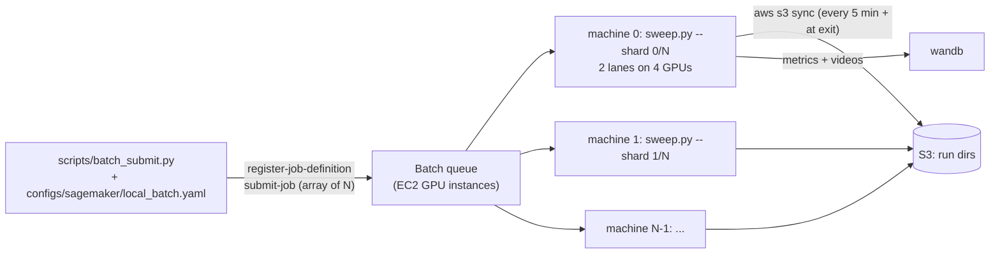

# AWS Batch (GPU containers)

Run a [sweep](sweeps.md) on an **AWS Batch job queue backed by EC2 GPU instances** (ECS), split over several
machines **in parallel**. It uses the same Docker image as [SageMaker](sagemaker.md). Use it when a plain GPU
queue has capacity and the SageMaker queues don't.



- **Sharding:** the sweep's runs are dealt round-robin over N machines. The job is one Batch **array job**,
  and child *i* runs `sweep.py --shard i/N` (`scripts/sweep.py::select`). Each machine trains `gpus // 2`
  runs side by side ([lanes](sweeps.md)): trainer on GPU 2*k*, its vLLM server on GPU 2*k*+1. By default N is
  chosen so every run gets its own lane, so the whole sweep runs at once.
- **The container** starts `docker/entrypoint.sh train` → `scripts/job_entry.py::main`. Without SageMaker's
  hyperparameters file, it reads `VLMRL_SWEEP`, `VLMRL_LANES`, `VLMRL_SHARDS`, `VLMRL_OVERRIDES`,
  `VLMRL_GROUP`, `VLMRL_ONLY` and `VLMRL_S3_OUTPUT` from the environment, and the shard from
  `AWS_BATCH_JOB_ARRAY_INDEX`. It downloads only the models of its own shard.
- **Outputs and resuming:** Batch has no checkpoint sync, so `scripts/job_entry.py::S3Syncer` restores
  `<s3_output>/<job>/` into the run dirs at start, uploads them every `VLMRL_SYNC_EVERY` seconds (300), and
  uploads once more at exit. A retried child picks up its runs' `resume/state.pt` and continues.

## One-time setup

```bash
cp configs/sagemaker/example_batch.yaml configs/sagemaker/local_batch.yaml   # git-ignored; fill it in
aws ecr create-repository --repository-name <ecr_repository> --profile <profile> --region <region>
```

| key | what |
|---|---|
| `profile`, `region`, `queue` | AWS CLI profile, region, and the Batch job queue (EC2 compute environment with GPU instances) |
| `ecr_repository` | image repository in that account; images are tagged with the git commit |
| `job_role_arn` | the container's AWS identity; needs `s3:PutObject/GetObject/ListBucket` on `s3_output` |
| `execution_role_arn` | pulls the image and writes logs (e.g. a role with `AmazonECSTaskExecutionRolePolicy`) |
| `s3_output` | run dirs are synced to `<s3_output>/<job-name>/` |
| `gpus`, `vcpus`, `memory_mib` | per machine; must fit one instance type of the compute environment (e.g. g6e.12xlarge: 4 GPUs, 48 vCPUs) |
| `shm_mib` | `/dev/shm` size; vLLM needs far more than Docker's 64 MB default |
| `max_hours`, `retry_attempts` | per-machine time limit; Batch retries (retried children resume from S3) |
| `tags`, `env`, `secret_env` | as for [SageMaker](sagemaker.md#one-time-setup); tags are propagated to the instances |

## Build, push, submit

The image is built from the committed tree, as for SageMaker. Push it to the Batch account's registry:

```bash
IMAGE=$(python scripts/batch_submit.py --image)
aws ecr get-login-password --profile <profile> --region <region> | ssh <box> docker login --username AWS --password-stdin ${IMAGE%%/*}
ssh <box> "cd <checkout at this commit> && docker/build.sh $IMAGE" && ssh <box> docker logout ${IMAGE%%/*}

export WANDB_API_KEY=...
python scripts/batch_submit.py configs/sweeps/batch_small_fft.yaml --dry_run      # job definition + request
python scripts/batch_submit.py configs/sweeps/batch_small_fft.yaml \
    --group small-fft-smoke --set steps=2 --set eval_every=1 --set eval_episodes=8 --max_hours 2   # smoke test
python scripts/batch_submit.py configs/sweeps/batch_small_fft.yaml                # 8 runs on 4 machines at once
```

| flag | |
|---|---|
| `--shards N` | machines (default: ceil(#runs / lanes)) |
| `--lanes L` | lanes per machine (default `gpus // 2`) |
| `--only REGEX` | only runs whose name matches, e.g. `--only qwen3vl2b` |
| `--set`, `--group`, `--max_hours`, `--tag`, `--dry_run` | as for `scripts/sagemaker_submit.py` |

Every submit registers a new revision of the job definition (`<ecr_repository>-gpu<gpus>`) pointing at the
image tag. Old revisions keep working for jobs that are still queued.

## Monitor

```bash
aws batch describe-jobs --jobs <jobId> --query 'jobs[0].{status:status,array:arrayProperties.statusSummary}'
aws batch describe-jobs --jobs <jobId>:<i> --query 'jobs[0].container.logStreamName'     # child i
aws logs tail /aws/batch/job --log-stream-names <logStreamName> --follow
aws s3 ls <s3_output>/<job-name>/<group>/
```

The container log has the entry script's output and each lane's start and exit lines. Each run's `train.log`
and each lane's `vllm_<model>_lane<k>_shard<i>.log` are synced to S3 with the run dirs.

## The shipped sweep: small-model full fine-tuning

`configs/sweeps/batch_small_fft.yaml` full-fine-tunes the four models of ≤ 2.2B parameters on 48 GB GPUs:
`qwen3vl2b_full`, `smolvlm2_2b_full`, `minicpmv46_full` and `smolvlm256m`, on UMaze and medium. That is 8 runs on
4 machines × 2 lanes. Every parameter is trained with fp32 master weights ([memory](../models/index.md#memory)).
These models mostly fail the PEAR action format zero-shot (74–100% invalid actions in earlier sweeps). With
terminate-on-invalid and a sparse reward, every group then scores the same and nothing trains. So the sweep
uses the simple prompt and the dense reward `success+0.5*neg_dist`.
