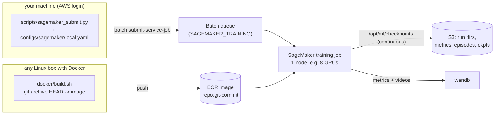
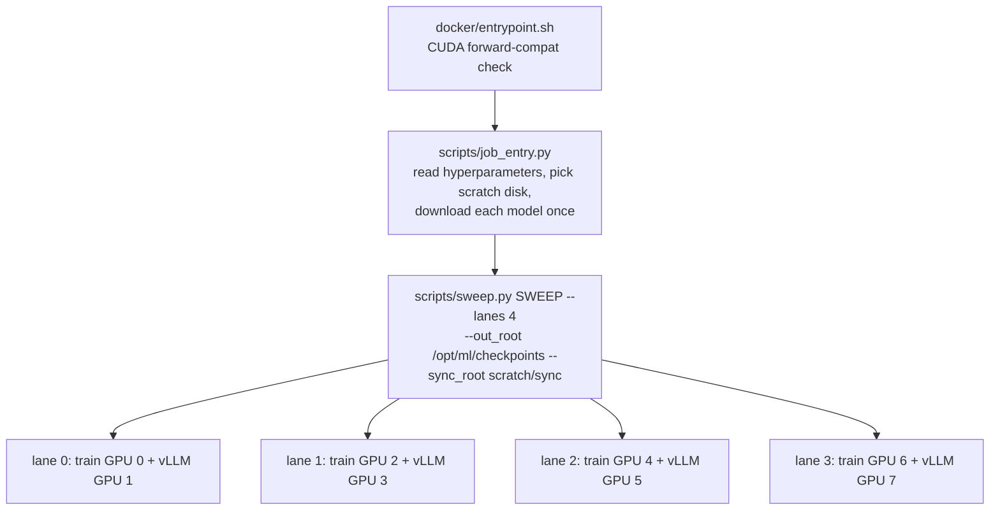

# SageMaker (AWS Batch)

Run a [sweep](sweeps.md) as **one SageMaker training job on one multi-GPU node**. The job runs
`scripts/sweep.py --lanes N`, so an 8-GPU node trains 4 runs at once: each lane has one training GPU and
one vLLM GPU. The job is submitted to an **AWS Batch service-job queue** (type `SAGEMAKER_TRAINING`),
which queues it under the queue's fair-share policy and then creates the SageMaker training job.



Inside the job:



## One-time setup

1. **Account settings.** Copy the template and fill it in. `configs/sagemaker/local*.yaml` is git-ignored
   and excluded from the image, so account ids, roles, buckets and tags never enter the (public) repo.

    ```bash
    cp configs/sagemaker/example.yaml configs/sagemaker/local.yaml
    ```

    | key | what |
    |---|---|
    | `profile`, `region` | AWS CLI profile (e.g. an SSO profile in `~/.aws/config`) and region |
    | `queue`, `share_identifier` | the default Batch queue (type `SAGEMAKER_TRAINING`) and its fair-share identifier |
    | `scheduling_priority`, `retry_attempts` | fair-share queues require a priority (higher runs sooner within the share); Batch retries (runs resume) |
    | `queues` | per-queue settings applied with `--queue <name>`, e.g. `instance_type`, `retry_attempts`, extra `env` |
    | `instance_type`, `volume_gb`, `max_hours` | must match the queue's service environment; default time limit |
    | `ecr_repository` | image repository; images are tagged with the git commit |
    | `role_arn` | SageMaker execution role (needs S3 access to `s3_output`) |
    | `s3_output` | outputs go to `<s3_output>/<job>/checkpoints` |
    | `tags` | cost-allocation tags, if your organization requires them on jobs |
    | `env` | plain environment variables for the job (e.g. `WANDB_BASE_URL`) |
    | `secret_env` | names of variables copied from **your shell** at submit time (e.g. `WANDB_API_KEY`) |

2. **Image repository** (once):

    ```bash
    aws ecr create-repository --repository-name <ecr_repository> --profile <profile> --region <region>
    ```

## Every code change: build and push the image

The image is built from the **committed** tree (`git archive HEAD`), so commit first. Uncommitted edits,
untracked files, local configs and keys can't end up in it. Build on any x86-64 Linux machine with Docker
(GPUs not needed). The registry login is piped from the machine that has the AWS credentials:

```bash
IMAGE=$(python scripts/sagemaker_submit.py --image)       # <account>.dkr.ecr.<region>.amazonaws.com/<repo>:<commit>
REGISTRY=${IMAGE%%/*}
aws ecr get-login-password --profile <profile> --region <region> | ssh <box> docker login --username AWS --password-stdin $REGISTRY
ssh <box> "cd <repo checkout at the same commit> && docker/build.sh $IMAGE"   # builds + pushes
ssh <box> docker logout $REGISTRY
```

The image (`docker/Dockerfile`) has two Python environments, pinned to the versions verified on the dev box
(`docker/requirements-*.txt`, from `uv pip freeze`): `/opt/venv-train` (trainer, on `PATH`) and
`/opt/venv-vllm` (the vLLM server, `VLLM_BIN`). The base is `nvidia/cuda:13.2.1-base`. If the host
driver is older than CUDA 13.2, `docker/entrypoint.sh` switches to the image's forward-compatibility
libraries (supported on datacenter GPUs).

The same image runs outside SageMaker: `docker run --gpus all <image> python scripts/sweep.py <sweep> --lanes 4`.

## Submit

```bash
export WANDB_API_KEY=...                                  # every name in secret_env must be set
python scripts/sagemaker_submit.py configs/sweeps/sagemaker_gemma4_fft.yaml --dry_run   # print the request
python scripts/sagemaker_submit.py configs/sweeps/sagemaker_gemma4_fft.yaml
```

| flag | |
|---|---|
| `--set KEY=VALUE` | Hydra override for every run (replaces the sweep file's value), e.g. `--set steps=2` |
| `--group NAME` | override the sweep's group (wandb group + run-dir name), e.g. for a smoke test |
| `--lanes N` | parallel lanes (default: number of GPUs // 2) |
| `--max_hours H` | time limit (default `max_hours` from the config) |
| `--tag TAG` | image tag (default: the current commit; the script checks that it exists in ECR) |
| `--queue NAME` | submit to another queue; its `queues.<NAME>` settings apply (instance type, retries, env) |

A **smoke test** before a long job: same image, a few steps, separate group:

```bash
python scripts/sagemaker_submit.py configs/sweeps/sagemaker_gemma4_fft.yaml \
    --group gemma4-fft-smoke --set steps=2 --set eval_every=1 --set eval_episodes=8 --max_hours 1
```

**Choosing a queue.** Any `SAGEMAKER_TRAINING` queue whose nodes have ≥ 2 GPUs per lane works. On-demand and
spot queues run the same image. Spot capacity can be reclaimed, so give spot queues `retry_attempts: 3`: retried
jobs resume from the S3 checkpoints. To see which queues have free capacity:

```bash
for q in $(aws batch describe-job-queues --query "jobQueues[?jobQueueType=='SAGEMAKER_TRAINING'].jobQueueName" --output text); do
  echo "$q running=$(aws batch list-service-jobs --job-queue $q --job-status RUNNING --query 'length(jobSummaryList)' --output text)" \
       "waiting=$(aws batch list-service-jobs --job-queue $q --job-status RUNNABLE --query 'length(jobSummaryList)' --output text)"
done
```

**Batch rules learned on the first submissions** (`sagemaker_submit.py` handles them):

- Tags may not be set inside the SageMaker request. They go on the Batch job, which propagates them to the
  training job (`tags` in the config).
- Fair-share queues reject jobs without a `schedulingPriority`.
- Queues backed by reserved capacity reject jobs without `SM_USE_RESERVED_CAPACITY=1` in the environment.
  Set it in that queue's `queues.<name>.env`.

The submitted request is a plain SageMaker `CreateTrainingJob` request
(`scripts/sagemaker_submit.py::build_request`): the sweep, lanes, group and overrides travel as
hyperparameters, secrets as environment variables. Secrets are redacted in the printed request and never
kept. The request reaches the AWS CLI as a 0600 file in a private temp dir, deleted right after the call. Anyone who can describe the training job in the account can read its environment, so
use keys meant for this.

## Monitor

```bash
aws batch describe-service-job --job-id <jobId> --query '{status:status,reason:statusReason}'
aws sagemaker list-training-jobs --name-contains <job-name> --query 'TrainingJobSummaries[].[TrainingJobName,TrainingJobStatus]'
aws logs tail /aws/sagemaker/TrainingJobs --log-stream-name-prefix <training-job-name> --follow
aws s3 ls <s3_output>/<job-name>/checkpoints/<group>/        # one dir per run, synced while it trains
```

Batch names the training job `AWSBatch<job-name><hash>`. The job's log has the entry script's output and
each lane's start/exit lines. Each run's `train.log`, and each lane's `vllm_<model>_lane<i>.log`, are in the
run directories on S3. wandb gets the usual metrics and episode videos, grouped by the sweep's `group`.

## Outputs, retries and resuming

- **Run dirs** live in `/opt/ml/checkpoints/<group>/<run>/`. SageMaker uploads this directory to
  `<s3_output>/<job>/checkpoints/` while the job runs, and restores it when a job is retried. Since
  [training resumes](index.md#resuming) from `resume/state.pt`, a retried or preempted job continues every
  run where it stopped. A spot queue is therefore fine for long sweeps.
- **What gets uploaded:** `resume/state.pt` is rewritten every `resume_every` steps. For full fine-tuning it
  holds the fp32 trainable weights and AdamW state (≈ 12 bytes per trainable parameter), so set
  `resume_every` to a few steps rather than 1. `save_every` writes HF checkpoints (bf16).
- **Not uploaded:** the per-step weights handed to vLLM (`--sync_root`, on the scratch disk) and the
  Hugging Face cache.

## Full fine-tuning with vLLM rollouts

LoRA runs sync by hot-loading adapters. Full fine-tuning syncs the whole model each step. The trainer writes
an HF-format checkpoint, and the server reloads it in place through vLLM's dev endpoints
(`/collective_rpc` → `reload_weights`, then `/reset_prefix_cache`). `scripts/launch_vllm.sh` enables those
(`VLLM_SERVER_DEV_MODE=1`, listening on 127.0.0.1 only), and sweeps start servers for `lora_rank=0` runs
with `ENABLE_LORA=0`. Details: [Rollout backends](backends.md#how-weight-sync-works).

Full fine-tuning keeps **fp32 master weights** for the trainable parameters (`fp32_master=true`, the
default) and runs the forward pass under bf16 autocast. Plain bf16 weights would silently drop most
updates. `freeze` (a regex) keeps parts of the model frozen in bf16, which is how
[Gemma 4 E2B](../models/gemma-4-e2b.md#full-fine-tuning) fits on one 80 GB GPU.

## The shipped sweep

`configs/sweeps/sagemaker_gemma4_fft.yaml`: Gemma 4 E2B full fine-tuning (`policy=gemma4_e2b_full`), PointMaze
with the PEAR protocol and the sparse success reward, 16 groups × 16, 40 steps, grid **maze {umaze, medium} ×
lr {1e-6, 5e-6}**. That is 4 runs, one per lane of an 8-GPU node, with the same task settings as the LoRA sweep
`pointmaze_small.yaml`, so the curves are comparable.
